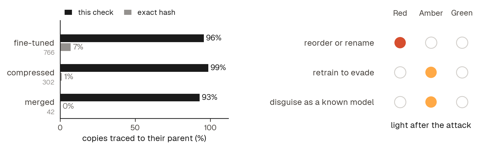
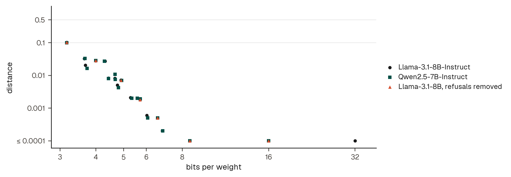

# Metal Detector for Open Source Misuse

*Madhav Khanal · November 2026*

## TL;DR

As open weight models become capable and accessible, there's a higher risk of misuse.
[UK AISI](https://www.aisi.gov.uk/blog/how-fast-is-autonomous-ai-cyber-capability-advancing) finds that the cyber
tasks frontier models can complete have doubled in length every 4.7 months since late 2024. Recent
[weight-space programming experiments](https://rikiyat.github.io/blog/weight-space-programming/) show frontier
LLMs inspecting and editing raw weights directly, making deployed weights to diverge from a
published checkpoint to intended goal promising. A provider can run safeguards, but to ensure privacy of users, they may see only a private model and a self-reported name, making inspection challenging. 

Building upon [SASH's inference prototype](https://github.com/sg-ai-safety-hub/inference-demo), this builds a lineage check robust to weight modifications. Inside a secure enclave, it compares the model's internal geometry with a
dangerous model watchlist and a registry of known models, then returns Red, Amber or Green. Weights and comparison scores
are fully private.

We ran an earlier version over 3,000 popular open-weight models and matched the listed parent for 1,070 of 1,110 models. We tested robustness on 27 existing fine-tunes, quantised releases, later versions and refusal-removed copies, and recovered the original lineage in all 27. 


*A verifier sends a fresh nonce after the weights are fixed. The enclave samples words, layers and text, compares
fingerprints and outputs, then signs one traffic light.*



*Left: copies among the 3,000 most-downloaded open models. Right: what a copy of a watchlisted model gets after
each attack. None reached Green.*

## Why check ancestry?

Open model ecosystems are built from descendants. Developers convert weights to smaller formats, tune them for
new tasks, merge checkpoints and publish later versions. Most of this is ordinary engineering. Some edits are
safety-relevant, such as removing refusal behaviour from a cyber-capable model.

A provider running private customer weights cannot rely on a model card or repository name. Exact attestation
helps with a different part of the problem. [SASH's verified inference
demo](https://github.com/sg-ai-safety-hub/inference-demo) shows that an enclave can prove a deployment runs the
same file an evaluation tested. Once that file is modified, its hash identifies the new bytes without recovering
their ancestry.

This checker asks whether a private deployment derives from a model on a public watchlist. The demo watchlist
contains [GLM-5.2](https://www.nist.gov/document/caisi-assessment-zais-glm-52),
[Kimi K3](https://www.aisi.gov.uk/blog/preliminary-assessment-of-kimi-k3s-cyber-capabilities) and
[GLM-5.3](https://www.nist.gov/news-events/news/2026/09/caisis-assessment-zais-glm-53-cyber-capabilities),
based on published findings from US CAISI and UK AISI. A second list contains known models with public origins.

Red means that one model part matches a watchlisted model, or that a known model shows a refusal-removal edit.
Amber means the origin is unknown. Green requires all checked parts together to match one known, non-watchlisted model.
These labels route deployments to different checks. They are not safety ratings.

## What is being compared?

A useful lineage signal should survive routine conversions without pulling independently trained models into
the same family. The checker samples a few weight matrices and asks how each matrix treats the same set of
words. For token embeddings \(E_S\) and a matrix \(W\), one fingerprint table is

$$T = E_S \hat W^{\top} \hat W E_S^{\top}.$$

An entry in \(T\) records how similarly the matrix treats a pair of words. Two model parts are compared by the
correlation between their tables. The reported distance is \(1-\text{correlation}\).

This choice removes several changes that alter bytes without altering the function. Reordering neurons does not
change a sum over neurons. Normalising rows removes neuron scale. A residual-stream rotation cancels through
\(R^{\top}R=I\). Tests cover these transformations to \(10^{-9}\).

The verifier chooses the words and layers from a fresh nonce after the model is fixed. This prevents an operator
from preparing weights for one known audit sample. Models with different token names are aligned by text first
and by token geometry when names are untrustworthy.

[`docs/METHOD.md`](docs/METHOD.md) contains the full definition and invariance proofs.

## Can the check trace model copies back to parent?

The starting point is the 3,000 most-downloaded open models. Many of them are copies of another model. Can the
check trace each copy back to its parent?

| Procedure for copy | Copies | Result |
|---|---|---|
| Fine-tuned | 766 | 96% traced to the right parent |
| Compressed | 302 | 99% traced to the right parent |
| Merged with other models | 42 | 93% traced to the right parent |
| Refusals removed | 99 | 90% flagged as edited |
| For comparison: a plain hash | 1,718 | recognises 4% of the copies the check found |

A hash only recognises an exact file, so it misses almost every modified copy. The first three lines come from
an earlier version of the reader.

Refusal-removal tools often subtract one direction from the model. Compared with the original, that shows up as
a small, clean edit, and the test looks for it. Fine-tuning can remove refusals without leaving that signature.

## Does it read the files people run?

Most public copies of the watchlisted models are compressed GGUF files, so the reader decodes them directly.



*Each dot is one compressed file, compared with the original it was converted from. The lines mark the Green
(0.1) and Red (0.5) thresholds.*

Compression barely moves the fingerprint. 35 of 36 honest files stayed Green. The one exception was a 2-bit
file.

For the three watchlisted models, the reader could open 100 public repositories. All 62 real copies were flagged
Red. None of the 38 look-alike models was.

## Will this work on online enclave?

An offline comparison is easy to rerun or alter. A deployment claim also needs evidence that the expected code,
lists and model were used. I ran the service in an AMD SEV-SNP enclave on Azure against the most-downloaded GGUF
copy of GLM-5.3. The model has 753 billion parameters and is split across eleven 4-bit files. The check took 99
seconds and returned Red.

The saved statement verifies offline. Its evidence ties the result to the chip maker's certificate chain, the
exact code that ran, a fresh nonce and both model lists. The statement uses the format of SASH's inference demo.
Instructions and saved evidence are in [`enclave/`](enclave/).

## Can an adversarial operator bypass this?

Routine model conversions are one test; deliberate evasion is another. I gave the operator the code, model
lists and thresholds, while keeping the audit nonce secret. The attacks ran on small stand-in models.

| Attack | Result |
|---|---|
| Reorder, rescale or rename the internals | no effect |
| Retrain the copy to hide it | works after 500 to 1,250 steps, and only reaches Amber |
| Disguise a watchlisted model as a known one | failed in every run |
| Copy a known model's outputs too | impossible without giving up its own outputs |

Retraining can hide a copy, but it lands on Amber, which still means an identity check. No run made a
watchlisted model pass as a known one, though the experiments do not prove that none can.

The last line points to the fix. Before giving Green, also check the model's outputs: a disguised model cannot
answer like the known model and like itself at once.

A fingerprint is a summary of each matrix, not its full function. Different matrices can share a summary, and
training can search for them. So the fingerprint alone cannot stop an adaptive operator.

## Gaps?

Stress tests have reached 1.7 billion parameters. Larger adaptive runs remain untested. Long continued
pretraining also removes the signal, as in the coding and mathematics variants of Qwen2.5.

The reader supports safetensors and GGUF. Other formats receive Amber. The refusal-removal test can miss edits
made through fine-tuning, and it raised two false alarms among 310 other copies. The output check is an option
in the tool. One sealed run used it and then served the checked model from the same enclave.

Hardware attestation shifts trust to AMD's and Microsoft's signing keys. A production version should load and
serve the model in the same enclave, allowing one receipt to name the bytes used for both checking and
inference. Registry ownership and watchlist governance also remain policy decisions.

## Prior Work
This project starts from the work of the [Singapore AI Safety Hub](https://github.com/sg-ai-safety-hub) (SASH).
Its [verified inference demo](https://github.com/sg-ai-safety-hub/inference-demo) and
[evaluation registry](https://github.com/sg-ai-safety-hub/double-blind-eval-registry) show that an enclave can
prove a deployment serves the exact model that was evaluated. This check reuses their statement format and
extends the proof to modified copies. [Zac Richardson](https://newsletter.aipolicybulletin.org/p/middle-powers-should-invest-in-ai)
argues that checking a commercial operator against local rules is a lower bar than verifying an international
agreement, and reachable with modest improvements on existing tools. That lower bar is the target here.

[HuRef](https://arxiv.org/abs/2312.04828) introduced invariant weight fingerprints for language models.
[Zhu et al.](https://arxiv.org/abs/2502.12292) developed statistical tests for shared initialisation, while
[Horwitz et al.](https://arxiv.org/abs/2405.18432) recovered family trees of public models.
[Nasery et al.](https://arxiv.org/abs/2509.26598) showed that training against a fingerprint can defeat it.
[Nikolić et al.](https://arxiv.org/abs/2502.00706) test a model's origin from its outputs alone, the closest prior
work to the output check here.
[O'Gara et al.](https://arxiv.org/abs/2505.03742) surveyed hardware verification for AI workloads, and
[Casper et al.](https://arxiv.org/abs/2608.07514) identified model heritage inference as an open problem in
open-weight risk management. [Takehi et al.'s weight-space programming
experiments](https://rikiyat.github.io/blog/weight-space-programming/) are adjacent motivation: frontier LLMs
read and edit raw weights directly, though they do not perform lineage verification.

This implementation combines an invariant matcher with a private load-time protocol, a public watchlist and an
asymmetric policy: one matching part is enough to flag, while clearance requires a match across the sampled
model. It emits statements in SASH's format. [`docs/PRIOR_WORK.md`](docs/PRIOR_WORK.md) has the longer review.

## Try it

```bash
git clone https://github.com/actionproject-madhav/ai-verification && cd ai-verification
pip install -e .
lineage-check light --query nvidia/GLM-5.2-NVFP4 \
    --watchlist watchlists/government-named.json --known watchlists/known-demo.json
```

```text
RED  glm-5.2  (part of the model matches a listed model)
  glm-5.3                  closest part 0.040   all parts 0.084
  kimi-k3                  closest part 0.962   all parts 0.980
  glm-5.2                  closest part 0.000   all parts 0.000
```

The command reads selected matrices over HTTP range and does not download the full model. It requires Python
3.11 or newer and no GPU. The numbers shift slightly between runs, because each run draws a fresh nonce.

The saved enclave statement can be verified with:

```bash
python enclave/verify_statement.py demo/azure-light/response.json --nonce $(cat demo/azure-light/nonce.txt) \
    --watchlist watchlists/government-named.json --known watchlists/known-demo.json --policy demo/azure-light/policy.b64
```

Run `pip install -e ".[dev]" && pytest` for the tests. `python experiments/headline.py` recomputes the headline
numbers from `results/`. [`docs/RESULTS.md`](docs/RESULTS.md) maps each result to its script and data file;
[`docs/DESIGN.md`](docs/DESIGN.md) describes the policy and enclave protocol.

The code is Apache-2.0. `lineage_check/fourpillars.py` is adapted from SASH's inference demo; see `NOTICE`.
