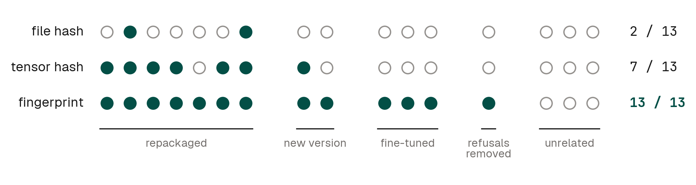

# Metal Detector for Open Source Misuse

*Madhav Khanal · November 2026*

## TL;DR

As open weight models become capable and accessible, there's a higher risk of misuse. Crude methods of hash checking fail as models can be quantised,
fine-tuned, merged or stripped away from safety trainnig. Recent
[weight-space programming experiments](https://rikiyat.github.io/blog/weight-space-programming/) show frontier
LLMs inspecting and editing raw weights directly, making deployed weights to diverge from a
published checkpoint convenient for anyone.

For privacy at deployment, a provider may see only a private model and a self-reported name. 

This built a lineage check robust to weight modifications. Inside a secure enclave, it compares the model's internal geometry with a
signed dangerous model watchlist and a registry of known models, then returns Red, Amber or Green. Weights and comparison scores
stay private.

In the current evaluation, 27 modified copies scored below 0.07 from their source and 151 unrelated pairs scored
above 0.83. Whole-file hashes found 2 of 13 public copies in a smaller audit; the fingerprint found 13.
Retraining against the check can still move a listed model from Red to Amber, so the result is useful for triage
rather than proof against an adaptive attacker.


*A verifier sends a fresh nonce after the weights are fixed. The enclave samples words and layers, compares
fingerprints, then signs one traffic light.*


*Distance near zero suggests shared lineage. Distance near one suggests independent training. Grey crosses are
models changed by long continued pretraining.*

## Why check ancestry?

Open model ecosystems are built from descendants. Developers convert weights to smaller formats, tune them for
new tasks, merge checkpoints and publish later versions. Most of this is ordinary engineering. Some edits are
safety-relevant, such as removing refusal behaviour from a cyber-capable model.

A provider running private customer weights cannot rely on a model card or repository name. Exact attestation
helps with a different part of the problem. [SASH's verified inference
demo](https://github.com/sg-ai-safety-hub/inference-demo) shows that an enclave can prove a deployment runs the
same file an evaluation tested. Once that file is modified, its hash identifies the new bytes without recovering
their ancestry.

This checker asks whether a private deployment derives from a model on a public watchlist. The demo watchlist
contains [GLM-5.2](https://www.nist.gov/document/caisi-assessment-zais-glm-52),
[Kimi K3](https://www.aisi.gov.uk/blog/preliminary-assessment-of-kimi-k3s-cyber-capabilities) and
[GLM-5.3](https://www.nist.gov/news-events/news/2026/09/caisis-assessment-zais-glm-53-cyber-capabilities),
based on published findings from US CAISI and UK AISI. A second list contains known models with public origins.

Red means that one model part matches a watchlisted model, or that a known model shows a refusal-removal edit.
Amber means the origin is unknown. Green requires each checked part to match one known, non-watchlisted model.
These labels route deployments to different checks. They are not safety ratings.

## What is being compared?

A useful lineage signal should survive routine conversions without pulling independently trained models into
the same family. The checker samples a few weight matrices and asks how each matrix treats the same set of
words. For token embeddings \(E_S\) and a matrix \(W\), one fingerprint table is

$$T = E_S \hat W^{\top} \hat W E_S^{\top}.$$

An entry in \(T\) records how similarly the matrix treats a pair of words. Two model parts are compared by the
correlation between their tables. The reported distance is \(1-\text{correlation}\).

This choice removes several changes that alter bytes without altering the function. Reordering neurons does not
change a sum over neurons. Normalising rows removes neuron scale. A residual-stream rotation cancels through
\(R^{\top}R=I\). Tests cover these transformations to \(10^{-9}\).

The verifier chooses the words and layers from a fresh nonce after the model is fixed. This prevents an operator
from preparing weights for one known audit sample. Models with different token names are aligned by text first
and by token geometry when names are untrustworthy.

Token geometry caused a false lead in an earlier version. Two independently trained models from one developer
scored 0.40 because they shared a tokenizer and similar data. Projecting the shared token directions out of each
table moved the pair to 0.84 and left measured copies close to their sources. The evaluation was rerun after
that change.

[`docs/METHOD.md`](docs/METHOD.md) contains the full definition and invariance proofs.

## What else did the audit find?

The separation plot tests the central measurement. Deployment raises a few more practical questions: whether
the fingerprint improves on hashes, whether it agrees with public provenance, and whether simple obfuscations
change the result.



The hash comparison used 13 public derivatives and three unrelated controls. A whole-file hash recognised 2
derivatives. Sampling tensor hashes recognised 7. The fingerprint recognised 13 and left the controls
unmatched. In a scan of 3,000 popular text models, only 74 of the 1,718 copies linked to a base by the
fingerprint shared a weight file with that base.

The scanner could read 2,577 models in that larger scan. Where both a model and its declared base were readable,
the weights agreed with 1,070 of 1,110 declarations. It also linked 465 of 1,049 models with no declared base to
a registry model. Long training, merges and resized architectures account for many disagreements, so this is a
metadata audit rather than a verdict on model cards.

Refusal-removal tools often subtract one direction from matrices that write to the residual stream. Compared
with the original, this appears as a low-rank edit. The current test finds roughly nine in ten public cases it
can compare. Fine-tuning can remove refusals without leaving that signature.

Relabelling token rows also failed in the measured cases. Geometry matching recovered four shuffled copies of
watchlisted models and did not change the results for five unrelated controls.

## What did the enclave prove?

An offline comparison is easy to rerun or alter. A deployment claim also needs evidence that the expected code,
lists and model were used. I ran the service in an AMD SEV-SNP enclave on Azure against the most-downloaded GGUF
copy of GLM-5.3. The model has 753 billion parameters and is split across eleven 4-bit files. Reading headers and
selected matrices from two layers took 99 seconds and returned Red.

The saved statement verifies offline. Its evidence ties the result to an AMD certificate chain, Microsoft's
platform endorsement, a fresh nonce, the statement key, the launch policy, and the digests of both model lists.
The statement uses the in-toto and DSSE format from SASH's inference demo. Instructions and saved evidence are
in [`enclave/`](enclave/).

## Can an operator evade it?

Routine model conversions are one test; deliberate evasion is another. I gave the operator the code, model
lists and thresholds, while keeping the audit nonce secret. Reordering, scaling and rotating weights left the
fingerprint unchanged. Geometry matching handled a relabelled tokenizer. Combining known attention layers with
unrelated MLPs produced Amber because only part of the model matched.

Retraining works better.


A 135 million parameter model left Red after 500 steps. A 1.7 billion parameter model took 1,250 steps. Both
became Amber. In the longer forgery test, the closest run reached 0.34 from a known model after 10,000 steps;
Green requires each part to be below 0.1. The curve was still falling, so the experiment does not establish a
lower bound on the cost of forgery.

Starting from a known model and training it to imitate a listed one left it Green. Its activations and behaviour
still resembled the known starting model. This is the expected outcome: ordinary fine-tuning should not change
lineage.

A fingerprint table records a second-order summary of a matrix rather than its full function. Different
matrices can share that summary, and gradient descent can search for them. Successful erasure leads to Amber
and another identity check, but the fingerprint alone cannot stop an adaptive operator.

## Where does it stop?

Stress tests have reached 1.7 billion parameters. Larger adaptive runs remain untested. Long continued
pretraining also removes the signal: five coding and mathematics variants of Qwen2.5 scored between 0.63 and
0.95 from their starting base.

The reader supports safetensors and GGUF. EXL3, MLX and other unsupported formats receive Amber. The
refusal-removal test can miss edits made through fine-tuning and produced two false alarms among 314 other close
copies. Green is strict enough that one honest 4-bit release scored 0.22 and would receive Amber.

Hardware attestation shifts trust to AMD's and Microsoft's signing keys. A production version should load and
serve the model in the same enclave, allowing one receipt to name the bytes used for both checking and
inference. Registry ownership and watchlist governance also remain policy decisions.

## How does this relate to prior work?

[HuRef](https://arxiv.org/abs/2312.04828) introduced invariant weight fingerprints for language models.
[Zhu et al.](https://arxiv.org/abs/2502.12292) developed statistical tests for shared initialisation, while
[Horwitz et al.](https://arxiv.org/abs/2405.18432) recovered family trees of public models.
[Nasery et al.](https://arxiv.org/abs/2509.26598) showed that training against a fingerprint can defeat it.
[O'Gara et al.](https://arxiv.org/abs/2505.03742) surveyed hardware verification for AI workloads, and
[Casper et al.](https://arxiv.org/abs/2608.07514) identified model heritage inference as an open problem in
open-weight risk management. [Takehi et al.'s weight-space programming
experiments](https://rikiyat.github.io/blog/weight-space-programming/) are adjacent motivation: frontier LLMs
read and edit raw weights directly, though they do not perform lineage verification.

This implementation combines an invariant matcher with a private load-time protocol, a signed watchlist and an
asymmetric policy: one matching part is enough to flag, while clearance requires a match across the sampled
model. It emits statements in SASH's format. [`docs/PRIOR_WORK.md`](docs/PRIOR_WORK.md) has the longer review.

## Try it

```bash
git clone https://github.com/actionproject-madhav/ai-verification && cd ai-verification
pip install -e .
lineage-check light --query nvidia/GLM-5.2-NVFP4 \
    --watchlist watchlists/government-named.json --known watchlists/known-demo.json
```

```text
RED  glm-5.2  (part of the model matches a listed model)
  glm-5.3                  closest part 0.040   all parts 0.084
  kimi-k3                  closest part 0.962   all parts 0.980
  glm-5.2                  closest part 0.000   all parts 0.000
```

The command reads selected matrices over HTTP range and does not download the full model. It requires Python
3.11 or newer and no GPU.

The saved enclave statement can be verified with:

```bash
python enclave/verify_statement.py demo/azure-light/response.json --nonce $(cat demo/azure-light/nonce.txt) \
    --watchlist watchlists/government-named.json --known watchlists/known-demo.json --policy demo/azure-light/policy.b64
```

Run `pip install -e ".[dev]" && pytest` for the tests. `python experiments/headline.py` recomputes the headline
numbers from `results/`. [`docs/RESULTS.md`](docs/RESULTS.md) maps each result to its script and data file;
[`docs/DESIGN.md`](docs/DESIGN.md) describes the policy and enclave protocol.

The code is Apache-2.0. `lineage_check/fourpillars.py` is adapted from SASH's inference demo; see `NOTICE`.
