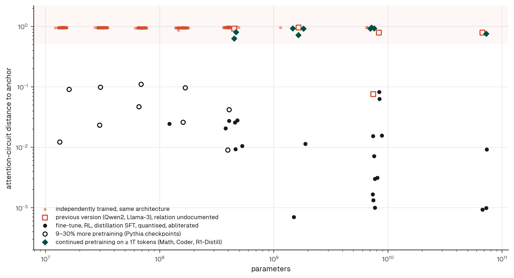

# lineage-check

A metal detector for model weights. Given a model and a list of open-weight models, it says whether the model is
a modified copy of one on the list, from the weights alone, and signs the answer.

## Why

A hash proves a server runs exactly one file. Fine-tune the model, quantise it, or strip its refusals, and the
hash changes. For a private model the hash then only shows the model is the same as last time. It cannot say what
the model is. That is how open-weight models get misused: someone edits a public model and runs the copy.

lineage-check compares wiring instead of bytes. An edit changes the bytes everywhere and the wiring very little.

## What you get

```
$ lineage-check verify --statement demo/operator/audit/huihui-ai__Qwen2.5-7B-Instruct-abliterated-v2.dsse.json \
      --pub demo/keys/pk.pem --nonce $(cat demo/operator/nonce.txt)
valid signature; subject huihui-ai/Qwen2.5-7B-Instruct-abliterated-v2@447ff10df7; verdict match -> qwen2.5-7b-instruct; refusal-ablation signature
```

That statement came from one scan (48 seconds, layers already cached):

```
$ lineage-check scan --query huihui-ai/Qwen2.5-7B-Instruct-abliterated-v2 --list demo/operator/concern.json \
      --nonce $NONCE --key keys/sk.pem --out st.json
```

- It reads a few layers, not the whole model. A 72B model was fingerprinted from 2 of its 80 layers, fetched with
  HTTP range requests.
- The statement holds the verdict, the matched entry, and one more bit: whether a refusal direction was cut out of
  the weights. No scores and no weights.
- Statements are in-toto in DSSE envelopes, in the format of SASH's
  [verified inference demo](https://github.com/sg-ai-safety-hub/inference-demo), so the check can run in a secure
  enclave beside it. See [`enclave/`](enclave/).

## How it works

1. The verifier sends a fresh random nonce after the weights are committed.
2. The nonce picks 512 tokens and a few layers. Nobody can prepare for a draw they have not seen.
3. For each layer the scanner computes token-by-token tables from the weights: how strongly attention links token
   `a` to token `b`, and what it writes when it does.
4. Distance is 1 minus the correlation between two models' tables. Under 0.5 against a listed model is a match.
5. The scanner signs the verdict.

Shuffling, rescaling or rotating a model's internals changes every byte and leaves these tables unchanged.
[`tests/`](tests/) checks that on a model built in milliseconds.

## Results so far

| Test | Result |
|---|---|
| 22 fine-tuned, quantised or abliterated copies | distance at most 0.08 from their parent |
| 231 pairs of separately trained models, 14M to 72B parameters | at least 0.86 |
| 36 pairs of unrelated 7-9B families | at least 0.96; true copies at that size 0.001 to 0.008 |
| 10 audit nonces, 2 or all layers, 64 or 512 tokens | no verdict changes |
| 150 popular Hub models | declared base confirmed for 81 of 91 readable; 19 undeclared bases found |
| Refusal ablation, from weights | flagged in 11 of 13 abliterated releases; 0 of 26 ordinary models |
| Retraining a copy to hide its origin | works, at no loss of quality |
| Retraining a copy to imitate a chosen harmless model | 0.45 after 1,000 steps; a close copy sits under 0.1 |

Every number traces to a file in [`results/`](results/). Full table: [`docs/RESULTS.md`](docs/RESULTS.md).



## The design it serves

The check is one layer of a larger mechanism, described in [`docs/DESIGN.md`](docs/DESIGN.md). When a model loads
in a cloud, an enclave sorts it into one of three results:

- **Green**: a close copy of a known model that is not on the list. It runs.
- **Red**: a copy or modified copy of a listed model, or its refusals were removed. Identity and content checks.
- **Amber**: no known origin. Identity check.

Hiding a model's origin moves it to Amber, not to Green.

## Limits

- Someone who retrains a copy against the check can hide its origin. The design treats "no known origin" as its
  own result for that reason.
- Heavy continued pretraining, a trillion tokens or more, moves a model out of reach of the weight fingerprint.
- The reader parses safetensors with Llama, Qwen, Mistral, OLMo, Granite and GPT-NeoX layouts, and AWQ, GPTQ and
  MLX quantisation. Not yet: GGUF, bitsandbytes, custom architectures. That left 20% of the 150-model sample unread.
- The red-team results are on 135M-parameter models. Larger runs are next.
- The matching idea is not new. See [`docs/PRIOR_WORK.md`](docs/PRIOR_WORK.md) for what is.

## Install

```
pip install -e .            # Python 3.11 or newer
pip install -e ".[dev]" && pytest
lineage-check keygen --dir keys
```

Downloaded weight slices go to `~/.cache/lineage-check`. Set `LINEAGE_ZOO` to move them.

## Repository

| Path | What |
|---|---|
| `lineage_check/` | reader, fingerprint, refusal-ablation signature, protocol and command line |
| `enclave/` | the check as an enclave service, with a Tinfoil config |
| `experiments/` | every experiment behind the results |
| `results/` | result files and signed statements |
| `demo/` | a toy audit of 15 Hub models, verifiable offline |
| `docs/` | design, results, prior work |
| `tests/` | invariance, robustness, protocol |

## License

Apache-2.0. `lineage_check/fourpillars.py` is adapted from SASH's inference-demo (Apache-2.0); see `NOTICE`.
