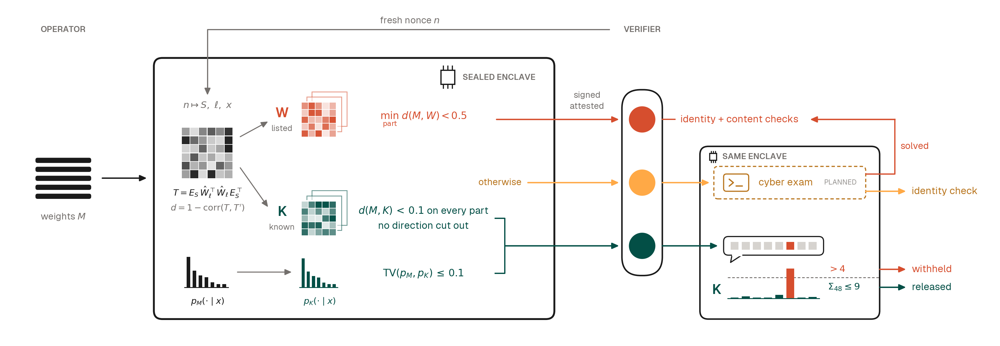
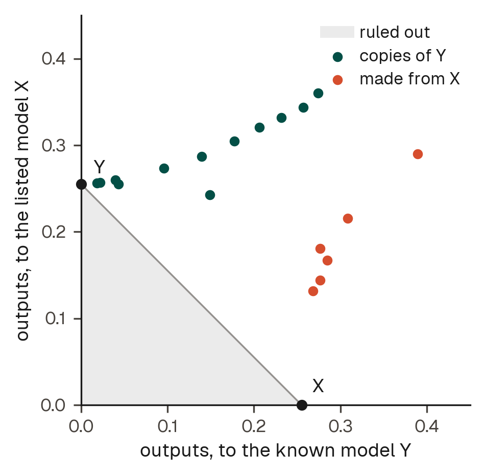
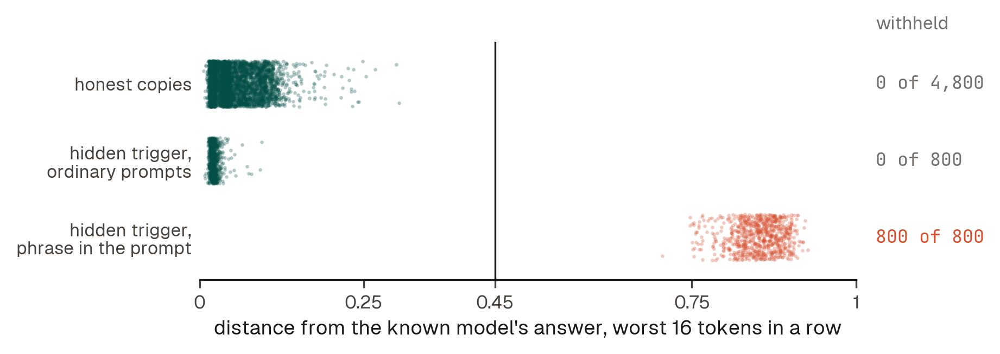

# Design: a check at load time

## The problem

Secure enclaves can prove which exact file a server runs. That proof is a hash, and any edit changes it. Open-weight
models are misused by editing them: a fine-tune, a 4-bit re-release, a removed refusal. So the hash cannot answer the
question a cloud provider or regulator has: is this deployment a modified copy of a high-risk open model?

The check has to work without anyone seeing the customer's weights, prompts or outputs.

## The mechanism

When a model is loaded, an enclave compares it with two public lists and outputs one of three results.

- `W`: a watchlist of high-risk open models.
- `K`: a registry of other known open models.
- `d(A, B)`: distance between the wiring of two models, from 0 (same) to about 1 (unrelated). It is computed per
  part of the model: each weight matrix that reads from or writes to the model's internal state gives one table.

| Result | Rule | What follows |
|---|---|---|
| Red | some part of `M` has `d < 0.5` to a model in `W`; or every part of `M` matches a model in `K` and one direction has been cut out of several layers | identity check, content checks |
| Green | not Red, every part of `M` has `d < 0.1` to one model in `K`, and `M` could be compared with that model matrix by matrix with no cut found | the model runs |
| Amber | otherwise | identity check |

The second way to be Red is for known models with their refusals removed. Tools that do this subtract one
direction from the matrices that write to the model's internal state, and that shows when the copy is compared
with the known model matrix by matrix (`docs/METHOD.md`). A copy that cannot be compared that way, because it was
shuffled or laid out differently, is Amber: it is not cleared on its tables alone. The tool keeps an older test
for removed refusals that needs no known model and can make any model Red. It is the weaker of the two.

"Some part" is the best-matching third of the model's tables and "every part" is all of them on average.

The enclave signs the result. The statement carries the result, the matched entry, the rule that decided and the
nonce. It carries no weights, no distances and no user data.

*Left: the check at load, which decides the light. Right: what follows in the same enclave. A model that is not Red
would first sit a sealed exam of cyber tasks. That exam is planned and not built. A model that solves it would be
handled as Red, whatever its light; for a Green model the exam need only run once, on the known model it matches.
An Amber model then goes to an identity check. Every answer of a Green model is scored by the known model K, token
by token: a bar is how much less likely K finds a token than its own first choice. The answer is withheld if one
bar is above the line (4 nats), or if 48 tokens in a row add up to more than 9.*

## Why flagging and clearing use different rules

Being flagged takes one matching part. Being cleared takes all of them.

A model built from pieces shows why. Take the attention weights and embeddings of a known model and attach other
MLP weights. In the test suite's small model, the closest part of that mix sits at distance 0.00 from the known
model, and its parts taken together sit at 0.41. A single threshold on the closest part would clear it. The rule above returns Amber, because the MLP half matches
nothing known. The same construction with a listed model's parts returns Red, because one matching part is enough
there. Both cases are in `tests/test_light.py`. A part counts as matching in the embedding space it was trained
with: the tables are built on the model's own token embeddings. The listed model's MLPs placed under another
model's embeddings and attention do not match it (0.93 in the stress tests), and that mix is Amber.

Most real copies stay far inside both thresholds. Instruct versions and fine-tunes of 7 to 8B models sit at
0.0005 to 0.004 on every part. Separately trained models sit above 0.83. Coarse quantisation is the exception on
the Green side: a plain 2-bit GGUF file of a known model sits at 0.105 on all parts, and one 4-bit release at
0.22.

## What the check does not take on trust

Everything the enclave reads comes from the operator, so the check leans on as little of it as it can.

| What the operator supplies | What the check does instead of trusting it |
|---|---|
| tensor names and the architecture | finds the matrices from their shapes and matches them by content |
| the tokenizer file, which says which row is which token | if no listed model matches by token name, matches tokens by the geometry of the token table |
| which tokens and layers get read | draws them from the verifier's nonce, after the weights are fixed |

The second row matters because relabelling is free. A tokenizer file that names the wrong rows makes tables
compare the wrong tokens, and a copy then looks unrelated. Principal coordinates of the token table do not depend on row order or on
a rotation, so tokens can be paired from geometry alone. A 4-bit copy of GLM-5.2 with its rows shuffled is Amber
by name and Red by geometry (`results/relabelled.json`).

## Where the lists come from

`W` should not be one team's opinion. The rule used here: a model is listed once a government evaluation body
publishes that it is the most cyber-capable open-weight model at release, or that it outperforms a model so named.
Derivatives inherit the listing. In November 2026 that gives three models, each with its source in
[`watchlists/government-named.json`](../watchlists/government-named.json):

| Model | Finding | Source |
|---|---|---|
| GLM-5.3 | named the most cyber-capable open-weight model released to date | US CAISI, September 2026 |
| Kimi K3 | outperforms GLM-5.2 on the same evaluations; safeguards did not prevent offensive cyber work | UK AISI and US CAISI, July 2026 |
| GLM-5.2 | probably the most capable open-weight model when released; safeguards on open weights can be circumvented when self-hosted | US CAISI, July 2026 |

Independent evaluators point at the same models.
[SaferAI's evaluation of GLM-5.2](https://www.safer-ai.org/research/glm-5-2-evaluation-report) finds frontier-level
capability on cyber benchmarks without the safeguards frontier developers apply, and notes that a user can run the
weights and avoid any filter. [Epoch's Cyber ECI](https://epoch.ai/data-insights/open-closed-cyber-eci-gap) ranks
GLM-5.3 the top open-weight model. The rule can take other sources: a list is a file of model revisions, and the
enclave pins its digest.

`K` can be built from public releases. The Hub scan in `experiments/exp_hub_scan.py` derives a first draft from
model cards: every repository that at least ten other cards name as their base. That rule is not enough. Twenty
of the 362 bases it picked are uncensored releases (19 say so in their names; the other is a Dolphin model). Three
of those could be read, and a copy of one of them would be cleared. A registry needs a curator, or a rule about who published the base.

## Who sees what

| Party | Sees |
|---|---|
| Customer | their own result |
| Cloud provider | the result for each deployment |
| Regulator | counts of each result, and the signed statements on request |
| Anyone | the code, the lists, and the enclave's measurement |

## What the enclave proves

The check ran in an AMD SEV-SNP guest on Azure Container Instances. A verifier checks four things offline, with
`enclave/verify_statement.py`:

| Claim | Evidence |
|---|---|
| a genuine chip produced the report | signature chain to AMD's root key |
| the base system is unmodified | Microsoft's signature over the launch measurement |
| this exact code ran, with these settings | the report's `host_data` is the hash of the launch policy, which lists the image digests, commands and environment |
| this key signed the statement | the report's `report_data` is the hash of the statement key and the verifier's nonce |

The statement format, digest schemes and envelope are those of SASH's verified inference demo, and that demo's own
code opens the statement. See [`enclave/README.md`](../enclave/README.md).

The hardware evidence is four runs. The first used the project's first reader on a small model. The second used
the traffic light on a copy of a listed model and was decided by the first rule, a match by name. The third ran
the whole Green path on a copy of a small known model: weights, the cut test, tokens matched by geometry, the
output check, and then serving that model from the same enclave under the same key. The fourth sealed a private
model into the image, a known model with a hidden trigger: Green at load, two ordinary answers released, the
answer that used the trigger withheld, the next request refused, and a second check of the model Amber, each with
its own signed statement. Red by geometry, Red by the
cut test and Amber have run with the same code outside the enclave only. In the second and
third runs the enclave read the model from the Hub by byte range at a pinned revision, so those statements also
trust the Hub to serve the right bytes. In the first run it fetched the whole model and named it by hash. In the
fourth the served model's bytes are part of the image the launch policy pins, and the known model it is tested
against was fetched from the Hub at the revision the registry pins.

## Who can defeat it, and what they get

| Effort | Example | Result |
|---|---|---|
| None | run a public quantised or renamed copy of a listed model, or a later version | Red |
| Free edits | shuffle, rescale or rotate the internals | Red: these cannot move the tables |
| Free edits | relabel the tokenizer so names point at the wrong rows | Red: tokens are matched by geometry |
| Free edits | convert the model to GGUF and quantise it to a few bits per weight | Red: the reader decodes GGUF |
| Free edits | convert it to a format the reader does not decode (MLX, most EXL3 files, a few others) | Amber |
| A public tool | remove the refusals of a known model | Red in about 9 of 10 public cases that can be compared; Green in the rest |
| A public tool, then a free edit | remove the refusals, then shuffle the weights | Amber: the copy can no longer be compared matrix by matrix |
| Building a mixed model | a known model's attention with a listed model's MLPs | Amber: not every part matches, and the model did not work |
| Long retraining | continue training on far more data, as coding or maths versions do | Amber: the copy no longer matches |
| Retraining against the check | gradient steps that push the tables away while copying the parent's outputs | Amber after 500 to 1,250 steps, at some loss of quality |
| The same, pulling toward a known model | make every part of a listed model match a known one | Amber in every run so far; never Green |
| The same, and matching what the known model's layers compute | train against an activation check as well | Amber: the tables did not move. The activations did |
| Training a known model to imitate a listed one | distil the listed model into the known one | Green, and still the known model: its outputs and accuracy did not follow |
| Hiding a trigger in a known model | train a known model to switch behaviour on a secret phrase | Green at load: nothing read at load shows it. Every answer that used the trigger was withheld when served |

22 of the scanned repositories carry a listed model's name and advertise removed refusals. Eight are copies in
GGUF files that the reader could decode, most of them labelled 1 or 2 bits per weight, and all eight are Red at
0.03 or less. Six are other models under a listed name. Eight could not be read. No fine-tune of a listed model could be
tested. The Hub tags 36 repositories as fine-tunes or merges of one, and none of them holds a fine-tuned copy in a
format the reader decodes: they are tokenizers, vision towers, draft models and packed files. The evidence that
fine-tunes stay within reach comes from smaller bases.

Hiding an origin is possible, and the cheapest ways found are an unusual file format and a retraining run. Both buy
Amber, which still means an identity check. Green is the only result that waives checks, and no copy of a listed
model reached it. The runs are small: 135M and 1.7B parameters, ten thousand steps at most, with the two main
attacks repeated on a second family at 70M. `docs/METHOD.md` says why
matching tables cannot prove that two models compute the same thing, so a longer run may get there.
[`docs/RESULTS.md`](RESULTS.md) has every run.

## What could hold Green

Red only has to be costly to leave. Green waives checks, so it has to be hard to enter. The stress tests tried
the three things a check can read, each time with the same question: can a listed model X be made to match a
known model Y on it and still give X's outputs?

| What Green is tied to | Can X match Y on it and keep X's outputs? | Evidence, on a 135M pair unless a size is given |
|---|---|---|
| Weight tables, as in the tool today | not in these runs, and nothing rules it out | 0.34 from Y after 10,000 steps, where Green needs 0.1; keeping X's outputs did not slow the pull |
| What layers compute | yes, most of the way | from 0.41 to 0.12 from Y in 2,000 steps, inside the range of Y's honest derivatives, with X's outputs kept; at 360M, from 0.58 to 0.18 in 200 steps |
| Outputs | no | after both pulls the model is 0.28 from Y's outputs, and X itself is 0.255; at 360M, 0.25 against 0.24 |

Outputs are different in kind. Total variation between next-token distributions is a metric, so for any model
$m$ and any text

$$\mathrm{TV}(m, X) \ge \mathrm{TV}(X, Y) - \mathrm{TV}(m, Y).$$

A model within $\varepsilon$ of Y's outputs on a piece of text is at least $\mathrm{TV}(X, Y) - \varepsilon$
from X's on that text. More to the point, it computes there what Y computes, up to $\varepsilon$, wherever its
weights came from.

Measured on 23 models (`docs/RESULTS.md`). Faithful copies of Y, meaning its 8-bit, 6-bit and 5-bit files and
fine-tunes of up to 1,000 steps, are within 0.10 of its outputs and under 0.14 in every one of 128 text windows.
X and every model made from X are more than 0.18 away in every window.

So a stricter Green is possible. The enclave runs the loaded model on text the verifier picks after the weights
are fixed, compares its next-token distributions with the known model's, and signs whether they agree in every
window. The known model is public, so the verifier can compute its side. The tool has this check as an option
(`lineage-check light --outputs`, `lineage_check/outputs.py`): it runs both models itself and asks for a mean
distance of 0.10 or less, under half the distance between the two stand-in models at every size measured. The
sealed service runs it too, and one run on Azure went through it (`enclave/README.md`). It has four costs.

1. Only faithful copies pass. At this size a 4-bit file moves the known model's outputs by 0.14 to 0.21 and its
   published instruct version by 0.26, as much as swapping it for X. Such a copy would be Amber unless the
   registry lists that file, where a hash settles it, or that version itself. Larger models lose less to
   compression, slowly: the same 4-bit rounding moves outputs by 0.27 at 135M, 0.22 at 360M and 0.16 at 1.7B. A
   published instruct version stays as far from its base as X is at every size.
2. It sees the text that is probed and nothing else. The tool reads 32 windows and asks for a mean distance of
   0.10 or less. A model that is Y on most text and something else on one window in twenty usually passes: those
   windows add about 0.05 to the mean. A model built to answer as Y unless a trigger is present is not caught by
   probing at all. The table rule does not stop it either when the model is Y itself with a trigger trained in:
   every table matches, the outputs match, and in the test the tool gave such a model Green. The next section is
   the answer to this cost.
3. The probes have to come from the kind of text that matters. Agreement on encyclopedia text says little about
   exploit code.
4. It needs a forward pass at load time, where the tables need a few byte ranges.

## Keeping Green while the model is served

A check at load time says what a model is on the text it was shown. An operator can hide a behaviour behind a secret
phrase that no verifier's text contains. A known model with such a trigger trained in is Green at load: its tables
match and its outputs match (`docs/RESULTS.md`).

Searching for the phrase is the wrong contest. The operator picks it and can train against any search, and a first
attempt at one could not tell an honest copy from an attack.

The box does not have to search. It serves the model it checked, and after a Green light it holds the known model
too. Before it releases an answer it lets the known model read the prompt and the answer, and asks of every token:
would you have chosen this one? Each token gets a gap: how much less likely the known model finds it than its own
first choice. An answer is released if no token has a gap above 4 nats and no 48 tokens served in a row have gaps
adding up to more than 9. Any other answer is withheld and nothing about its text is signed. The box stops serving
and remembers: until it is restarted, every later check of that model is Amber and says how many answers were
withheld.

If every gap is zero, the answer is word for word what the known model would have written, so the test asks the
question directly. A first version compared the two models' distributions on the answer and was wrong: an answer
made of the known model's second choices barely moves the distributions and is a different text. It passed that rule
1,183 times in 1,200. This one withholds it every time it is asked for, whole or two tokens at a time.

A trigger that is never used is harmless. A trigger that plants text has to produce tokens the known model would not
have chosen, and those are what the test counts. What stays possible is steering inside the budget, the second cost
below. In the test, a known model with a hidden trigger passed every check at load, and all 1,591 answers that carried
its planted sentence were withheld. None of 8,800 answers from compressed copies and short fine-tunes was, judged one at
a time. Served back to back in random orders, one 5-bit file went over the budget about once in 27,000 answers, each
time next to the answer the budget was set from. A fine-tune of 1,000 steps lost 8 of 800 judged one at a time, and went
over in every order. One sealed run on Azure did the same, with a signed statement for each request
(`enclave/README.md`).

It has costs of its own.

1. The known model reads each prompt and answer once more. In the sealed run that added 0.15 seconds to an answer
   that took two seconds. A deployment could test a random share $p$ of answers instead. A trigger used $k$ times
   is then caught with probability $1 - (1 - p)^k$.
2. The two bars are room the operator keeps: in any 48 served tokens, two that the known model finds about 55 times
   less likely than its own choice, or eight it finds a third as likely. One tipped token early in an answer changes
   all that follows, so a released answer is a text the known model finds likely at every step, not its answer word
   for word. A look-alike model's own answer passes one time in three. An operator who spreads its requests among
   ordinary ones is held only by the cap. No attack was trained against this rule. Tighter bars leave less room and
   stop the least faithful honest copies, 5-bit files and fine-tunes.
3. Answers are decoded with the most likely token each time. With sampling the box would have to draw the random numbers
   itself.
4. One withheld answer ends the service, so a prompt that pushes an honest copy past the budget would stop it, and users
   can find such prompts: the known model is public, so the gaps of served answers can be computed. Short answers chosen
   that way and served back to back took four of the eleven that pass one at a time past the budget; one prompt asked 48
   times for a single token took seven, or ten if the prompt ends partway into an answer. The box's memory of it lasts
   until a restart, which a verifier sees only as a new boot time. Fine-tunes do this by themselves: a copy fine-tuned
   for 1,000 steps is Green at load and strays past the bars in one answer in a hundred. It needs its own registry
   entry.
5. The known model's weights have to be in the box. The registry lists public models, so they can be. Only Green is
   covered: a model that is Amber or Red has no known model to be tested against.

## Two kinds of Green: exact and close

The token test lets a better model's answer through whenever no token of it is more than 4 nats (about 55 times)
less likely under the known model than the known model's own choice, and no 48 tokens served in a row add up to more
than 9. For a capable known model that is most of a better model's lead when answers are served alone, and 43% to 79%
of it back to back, questions of fact included (`docs/RESULTS.md`, "What the room in the test is worth"). The room is
there because
a compressed copy does not compute exactly what the known model computes, and the box cannot tell which differences
are honest.

For many compressed copies it can. A GGUF file is made by a public encoder (llama.cpp's) from the known model's
numbers, and the encoder is deterministic once its build is fixed. So the box re-derives the file: it gives the known
model's tensors to the encoder in the format each tensor of the file names, and compares the bytes
(`lineage_check/derive.py`). The one setting a file does not record is whether the encoder's compiler fused a
multiply and an add, which decides some roundings (Liu and Tsai, who found it and the per-tensor recipe missing from
every popular file they read). The box tries four builds that differ only in that, and asks that one build wrote
every tensor. The token list must be the known model's too.

In the box the rule is stricter than re-deriving tensors: the file's architecture must be the known model's, the
file must hold every tensor of the known checkpoint and no other, each in a format the box can read, and the box
reads the query and key rows in the order llama.cpp writes for that architecture, by one rule shared with its
loader. A file that passes is Green on the **exact** basis. It holds nothing the known model does not, so what it
answers is a deterministic function of the known model and the formats the file names, with no room left for an
operator: the box serves it as it is. Every other Green is on the **close** basis and keeps the token test and the
room that comes with it. The signed statement says which (`LightStatement:v0.8`, field `basis`), and for an exact
file gives its formats, its bits per weight and its hash.

Exact is about what the file holds, not about how it behaves. Each tensor's format is the publisher's choice, and a
low-bit file is far from the model it came from: a published 2-bit copy of SmolLM is as far from it as the listed
model is. The output check still runs on an exact file and its result is signed; for such a file it says the outputs
differ. A deployment can set a floor on bits per weight, or hold files to llama.cpp's own recipe for the declared
type; the box does neither yet.

How often is a file exact? Of 1,266 published GGUF files declared as copies of 14 small open models, 477 re-derive from
the declared base with today's encoder and 5 with a release of 2024, and 72 more from a sibling model the card does not
name: 554, 44% (`docs/RESULTS.md`). Most of the
rest cannot be exact as published: a quarter are calibrated with an importance matrix, whose rounding depends on data
the publisher chose, and the official Qwen files are rescaled per channel with scales from calibration data. Such a
file could be made exact by publishing its calibration data and checking that too, but the data is then a free input,
and rounding directions alone are enough for a backdoor (QuRA).

Exact is not safe. It proves the file is what the encoder makes of the known model. A known model can be built so
that only its GGUF copies misbehave (Egashira et al., "Mind the Gap"), so the registry has to vet a known model's
quantised copies as well as the model.

The format of each tensor is the file's own choice: the box re-derives each tensor in the format the file names, so an
operator could choose formats tensor by tensor. That decides how coarse each tensor is, not which way any number
rounds. The box could also hold a file to the standard choice for its declared type; it does not yet.

Only the tensors come from the file. The box serves an exact file as a copy of the known model with the file's tensors
in it: the known model's own settings and tokenizer, not the ones written in the file. So the file's other contents
(its context length, its rotary settings, its chat template) do not reach what the box serves. Outside the box they
could: a file exact in its tensors can still be run with other settings.

## What the check does not do

- It does not read intent. The same weights serve research and abuse.
- It does not see behaviour. Outputs track training data more than origin: an independent model trained on similar
  data sits closer to a parent's outputs than some of that parent's honest fine-tunes. The section above uses
  outputs for a different question: whether a model computes what a known model computes, wherever it came from.
- It does not replace hashes. A hash is exact and cannot be fooled. The check covers what a hash cannot see.
- It does not clear what it cannot read. A model in a format the reader cannot fully decode is Amber.

## Open questions

1. File formats. Safetensors and GGUF are read. MLX, most EXL3 files, a few packed 4-bit layouts and GGUF files whose
   matrices use the 1 to 3 bit codebook formats are not, and a model the reader cannot decode is Amber.
2. Green while the model is served. The output check at load, the test of every served answer and Green on the
   exact basis are built. Not built: answers that are sampled, an attack trained against the test, a floor on the
   bits per weight of an exact file, and a check of the per-tensor recipe.
3. A cut test on tables instead of raw matrices, so that a shuffled copy can still be checked.
4. Scale. The stress tests stop at 1.7B parameters and ten thousand steps.
5. Refusal removal by fine-tuning leaves no cut direction. A behavioural probe inside the enclave may be needed.
6. Trust in the enclave vendor. The check is small and deterministic, so a second party can recompute it, and it is
   a candidate for a zero-knowledge proof.
7. Distilled copies. A model distilled from a listed one shares no weights with it; started from a known model it is
   Green. The sealed exam with teaching is measured on a stand-in, a domain of invented facts, and caught a distilled
   copy, a locked one and one trained against teaching (`docs/RESULTS.md`). Not done: an exam of real cyber tasks, a
   lock trained against the box's largest teaching, and the exam inside the enclave.
