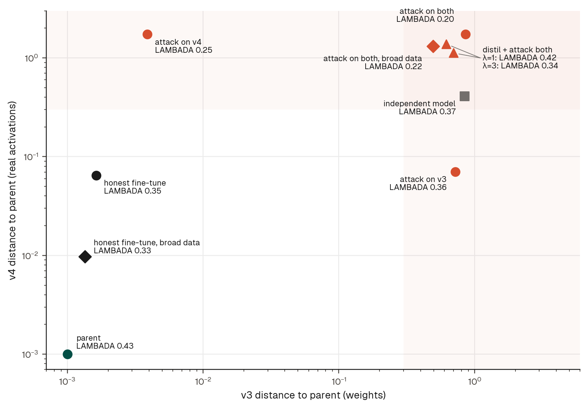

# Results

Each row names the file it comes from and the script that wrote it. Distances in the first table come from the
design-free fingerprint (closest part unless stated). Elsewhere they are attention-circuit distances (mean of QK
and OV) from the design-aware reader.

## Headline results (November 2026)

| Question | Result | File | Script |
|---|---|---|---|
| Public copies of the three government-named models (0.75 to 2.8 trillion parameters) | 14 of 14 readable copies match at 0.017 or less; 15 other models, some with look-alike names, at 0.79 or more | `results/watchlist.json` | `exp_watchlist.py` |
| What exact hashes recognise, on 13 public copies and 3 unrelated models | whole-file hash 2 of 13; per-tensor hash 7 of 13 (sample of 24 tensors); fingerprint 13 of 13; no method flags an unrelated model | `results/hash_baseline.json` | `exp_hash_baseline.py` |
| The traffic light on ten real models | 10 of 10 as expected: 5 Red (4 copies of listed models, 1 with refusals removed), 2 Green, 3 Amber | `results/lights.json` | `exp_lights.py` |
| Design-free fingerprint at 7 to 9B, all parts | instruct versions and fine-tunes 0.0004 to 0.004; refusals removed 0.069; unrelated 0.94 to 0.99 | `results/universal.json` | `exp_universal.py` |
| Sealed hardware (AMD SEV-SNP on Azure) | two runs; statements verify offline down to AMD's root, Microsoft's endorsement and the launch policy; Red for a renamed copy of GLM-5.3 in 84 seconds | `demo/azure/`, `demo/azure-light/` | `enclave/verify_statement.py` |

## Does it separate copies from strangers?

| Question | Result | File | Script |
|---|---|---|---|
| Exact reparameterisations, padding, vocabulary permutation | copy identified at 2e-12 or less; logits unchanged (5e-5) | `results/structural.json` | `exp_structural.py` |
| Calibration, 14M to 72B | 231 independent pairs 0.86 to 0.98; 22 cheap derivatives at most 0.082 (most under 0.03); 72B from 2 of 80 layers | `results/scale.json` | `exp_scale.py` |
| Unrelated 7-9B families (9 families, 36 pairs) | 0.962 to 1.017; Marin-8B against Llama-3.1-8B, same architecture and tokenizer, 0.995 | `results/crossfamily.json` | `exp_crossfamily.py` |
| Same pipeline on true copies at 7-9B | Llama-3.1-8B-Instruct 0.008; Qwen2.5-7B-Instruct 0.001 | `results/crossfamily_controls.json` | `exp_crossfamily.py` |
| Stability over the audit draw | 10 nonces, 4 settings: furthest cheap derivative 0.041, closest independent 0.70; no verdict changes | `results/stability.json` | `exp_stability.py` |
| Mixture of experts | expert shuffling and router shift 5e-15; Qwen3-30B-A3B derivatives 0.018 to 0.051 | `results/moe.json` | `exp_moe.py` |
| Merges | soups and cross-lineage merges attributed; frankenmerge layer attribution not solved | `results/merge.json` | `exp_merge.py` |

## Where does it stop for honest training?

| Question | Result | File | Script |
|---|---|---|---|
| Heavy continued pretraining | a trillion tokens or more (Qwen Math, Coder, R1-Distill) moves a model to 0.63 to 0.96 | `results/scale.json` | `exp_scale.py` |
| Drift along one training run | checkpoints a third of a run apart sit at about 0.06 to 0.13 | `results/drift.json` | `exp_drift.py` |
| Activation fingerprint (v4) on the same boundary | Qwen2.5-Coder at 0.19 to 0.20, previous generation 0.49 | `results/v4.json` | `exp_v4.py` |

## Lineage found without being told

| Finding | Distance | File |
|---|---|---|
| Llama-3.1-8B from Llama-3-8B | 0.076 | `results/scale.json` |
| OLMoE-0125 from OLMoE-0924 (the model card confirms) | 0.08 | `results/moe.json` |

## Public models

| Question | Result | File | Script |
|---|---|---|---|
| Toy audit, 15 Hub models, one nonce | 11 of 11 cheap derivatives matched, 8 of 9 abliterated flagged, 0 false flags | `demo/operator/audit/` | `lineage-check scan-batch` |
| Hub's declared base, 150 popular models | of 91 readable that declare one of five bases, 81 confirmed, 0 matched a different listed base | `results/hub_census_summary.json` | `exp_hub_census.py` |
| The 10 not confirmed | 4 merges whose recipes include Coder or Math parents; 3 7B models that declare a 1.7B base; 1 pruned; 2 audio or turn-detection models | same | `analyze_census.py` |
| Models that declare no base | 19 of 22 third-party models tied to a listed base; 4 of the 19 name it in their card text | same | same |
| Unreadable | 30 of 150: custom architectures and layouts; 15 more skipped as bitsandbytes, compressed-tensors or FP8 | `results/hub_population.json` | same |

## Refusal ablation

| Question | Result | File | Script |
|---|---|---|---|
| Abliterated releases on the Hub | 11 of 13 flagged | `results/census_v3.json` | `exp_census.py`, `rescore_census.py` |
| Ordinary models | 0 of 26 flagged | same | same |
| "Uncensored" models made by fine-tuning | 1 of 5 flagged: fine-tuning leaves no cut direction | same | same |
| After reparameterisation and 4-bit quantisation | still flagged | `results/forensics_small.json` | `exp_forensics.py` |

## Red team

All on SmolLM2-135M. v3 reads weights; v4 reads activations on secret probe text. LAMBADA accuracy of the
untouched parent: 0.428.

| Round | Attack | Result | File | Script |
|---|---|---|---|---|
| 1 | gradient attack on v3 | v3 moves to 0.72 at no loss; v4 still 0.07 | `results/adaptive_v3_train.jsonl`, `results/v4.json` | `exp_adaptive.py` |
| 1 | scrambling token embeddings | with a secret audit set: 60% of the pool must be scrambled, perplexity x47; with a leaked set: +0.24 nats | `results/adaptive_v3.jsonl` | `exp_adaptive.py` |
| 2 | attack on v4, then on both | neither single attack transfers; on both: v3 0.84, v4 1.74, LAMBADA 0.204 | `results/round2.jsonl`, `results/capability.json` | `exp_round2.py` |
| 3 | both, on the model's own pretraining data | v3 0.50, v4 1.32, LAMBADA 0.222; honest fine-tune on the same data 0.334 | `results/round3.jsonl` | `exp_round3.py` |
| 4 | both, while distilling the parent into itself | escapes both by step 200; best checkpoint LAMBADA 0.416. Hiding an origin is about free | `results/round4.jsonl` | `exp_round4.py` |
| 5 | imitate a chosen unrelated model (same shape and tokenizer) | 400 steps: 0.54 from the target. 1,000 steps with erasure: 0.45 from the target, 0.94 from the parent on v3; v4 still names the parent (0.03); LAMBADA 0.426 | `results/round5.jsonl` | `exp_forge.py` |

Behaviour is not a lineage test: mean KL to the parent on held-out text is 0.14 for the round-4 attacker, 0.13 to 0.95
for honest derivatives, and 0.42 for an independent model trained on similar data (`results/behavior.json`,
`exp_behavior.py`).

## Enclave

TinyLlama-1.1B-Chat at the revision SASH's inference demo serves, scanned by `enclave/lineage_service.py` as a local
twin: its base at 0.001 (match), an independent model with the same tokenizer at 0.983, a replayed nonce refused.
inference-demo's own code verifies the statement, recomputes the directory hash (`d1e29a1a...`, the value in its
crosswalk fixture), and links it to its inference statement for the same model (`demo/enclave/`).

