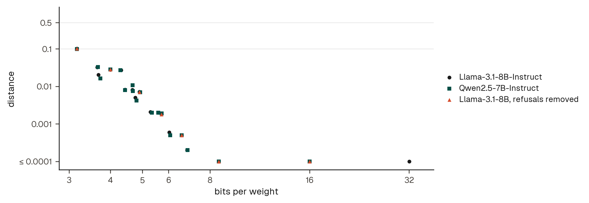
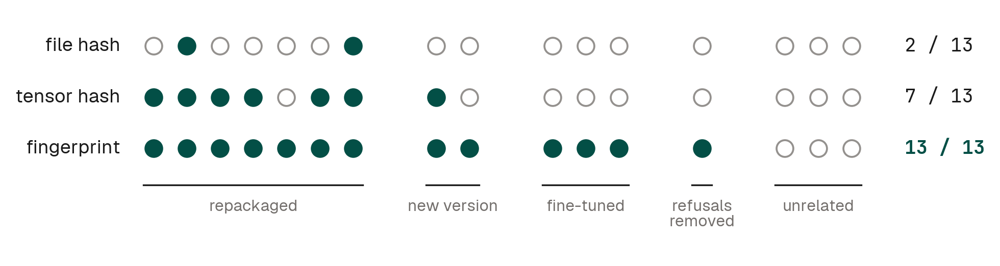
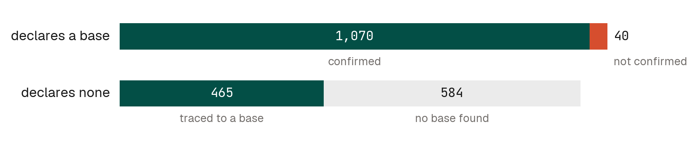
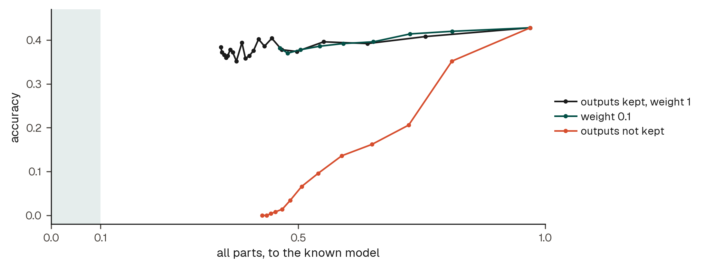

# Results

Each row names the file it comes from and the script that wrote it. Three readers appear on this page, and each
section says which one it used.

- The tool's reader builds one table per weight matrix and needs no knowledge of the architecture. Its distances
  are "closest part" and "all parts".
- The first reader, built earlier in the project, knows the common architectures and compares attention circuits.
  File names call it v3.
- The activation reader compares what layers compute on secret text. File names call it v4. It is not in the tool.

## The tool's reader

| Question | Result | File | Script |
|---|---|---|---|
| Modified copies against their base, 135M to 2.8T parameters | 27 copies (quantised, instruct, fine-tuned, refusals removed, later versions), all at 0.066 or less | `results/universal_pairs.json`, `results/universal.json`, `results/watchlist.json` | `exp_universal_pairs.py`, `exp_universal.py`, `exp_watchlist.py` |
| Unrelated pairs | 151 pairs, all at 0.839 or more; the closest are two sizes of one family from one developer | `results/universal_cross.json`, `results/watchlist.json` | `exp_universal_cross.py`, `exp_watchlist.py` |
| Public repositories around the three government-named models (0.75 to 2.8 trillion parameters), safetensors only | 178 found by the Hub's base-model tags and by name. 142 hold no safetensors weights and were skipped, 5 could not be read, 6 gave nothing to compare. 14 are copies (quantised and renamed releases, later versions) and all 14 match at 0.017 or less. 11 other models, some with look-alike names, sit at 0.95 or more | `results/watchlist.json` | `exp_watchlist.py` |
| The 142 skipped repositories, read as GGUF | 75 decode. 48 are copies of a listed model (1 to 4 bit releases, pruned copies, renamed copies, later versions) and all 48 match: 46 at 0.035 or less, a 2-bit later version at 0.10, a half-pruned 2-bit copy at 0.12. 8 of the 48 advertise removed refusals. The other 27 are different models (19 are GLM-5.3-Flash) at 0.95 or more. 67 stay unread: 49 hold no GGUF file, 10 keep the token table out of reach (drafts, per-layer splits, nonstandard variants), 4 are gated, 4 are not models | `results/watchlist_gguf.jsonl`, `results/watchlist_gguf_summary.json` | `exp_gguf.py watchlist` |
| Both scans together | 62 copies of listed models matched, 38 other models not matched, 78 of 178 unread | same | same |
| GGUF files of three public models against the safetensors original | 55 files of three models: Llama-3.1-8B-Instruct, Qwen2.5-7B-Instruct and an abliterated Llama-3.1-8B. 43 decode; 12 do not (IQ2 and IQ3 codebook formats, a 4-bit layout for ARM). All parts against the original: 0.002 or less at 5 bits per weight and above, 0.007 at 4.9 bits, 0.033 or less down to 3.6 bits, 0.10 for the plain 2-bit files. Against the known base, 35 of the 36 honest files are Green and one 2-bit file is Amber (0.105); the cut test flags none of them. It flags all 7 files of the abliterated model | `results/gguf_ladder.json` | `exp_gguf.py ladder` |
| What exact hashes recognise, on 13 public copies and 3 unrelated models | whole-file hash 2 of 13; per-tensor hash 7 of 13 (sample of 24 tensors); fingerprint 13 of 13; no method flags an unrelated model. The 4-bit releases keep the matrices the reader looks at in full precision, so their match is no evidence about 4-bit quantisation; the 8-bit releases are the test of quantisation | `results/hash_baseline.json` | `exp_hash_baseline.py` |
| The traffic light on seventeen real models, five of them GGUF files | 17 of 17 as expected under the first nonce: 7 Red as copies of listed models (3 of them GGUF files), 4 Red as known models with a direction cut out (1 GGUF), 3 Green (1 GGUF), 3 Amber. Over five nonces 16 keep their light. The 4-bit GGUF of the abliterated Llama-3.1-8B is Red on four and Green on one. For the same model as safetensors the rule that decides is the cut test on four nonces and the older signature on one | `results/lights.json`, `results/lights_stability.json` | `exp_lights.py` |
| All parts, on the 13 copies above plus 9 more | 21 of 22 under 0.1 (the Green bar); one release that stores its matrices in 4-bit blocks at 0.22 | `results/hash_baseline.json`, `results/universal_pairs.json` | same |
| Models retrained at length | five coding and maths versions of Qwen2.5 sit at 0.63 to 0.95 from the base they started from | `results/universal_pairs.json` | `exp_universal_pairs.py` |
| A later version found without being told | Llama-3.1-8B from Llama-3-8B: 0.059 (the first reader gives 0.076 for the same pair, further down) | `results/universal_pairs.json` | same |
| Unrelated models from one recipe, before and after token geometry is projected out | SmolLM-360M against SmolLM-135M: 0.40 before, 0.84 after; copies unchanged | `results/universal_cross.json` | `exp_universal_cross.py` |
| A tokenizer relabelled to hide a copy | four copies of listed models with their token rows shuffled behind the old names: Amber by name, Red once tokens are matched by geometry (0.011 or less). Five other cases are unchanged by the same pass: two models unrelated to the lists, one of them also relabelled, and two copies of known models | `results/relabelled.json` | `exp_relabelled.py` |
| A known model with its refusals removed: the cut test | 60 close copies named "abliterated": 10 cannot be compared (packed 4-bit copies and other layouts; the tool leaves them Amber), 1 identical to the base; of the 49 compared, 45 flagged, 4 cleared (the older signature flags 27). 55 named "heretic": 5 cannot be compared; of the 50 compared, 44 flagged, 6 cleared (older signature 0). 35 with looser hints ("uncensored", "dolphin" and the like, many of them fine-tunes): 5 cannot be compared, 1 identical; of the 29 compared, 14 flagged, 15 cleared (older signature 8). 400 with no such name: 54 cannot be compared, 36 identical; of the 310 compared, 9 flagged, 9 not aligned with the base (Amber), 292 cleared (older signature 3). Of those 9, five say in their cards that refusals were removed, one is compared with a registry base that is itself uncensored, two show the same cut and say nothing, and one is a false alarm (a model edited to resist refusal removal). By the first two conditions alone the flagged counts are 46, 45, 18 and 34 | `results/refusal_edit.jsonl`, `results/refusal_edit_summary.json` | `exp_refusal_edit.py` |
| The cut test on seven pairs, four nonces each | three refusal-removed models: 3 to 6 cut layers of six, Red by the cut test on 12 of 12 nonce runs; four honest versions of the same bases: no cut layer on any of 16 runs; all aligned | `results/cut_pairs.json` | `exp_cut_pairs.py` |
| Sealed hardware (AMD SEV-SNP on Azure) | two runs. The first (`demo/azure/`) used the first reader in match mode on TinyLlama. The second (`demo/azure-light/`) used the traffic light on `unsloth/GLM-5.3-GGUF`, the most-downloaded GGUF copy of a listed model, as a 4-bit file in eleven shards: Red in 99 seconds, decided by a match by name. An earlier run on an 8-bit safetensors copy took 122 seconds. Both statements verify offline down to AMD's root, Microsoft's endorsement and the launch policy. Matching by geometry, the cut test, Green and Amber have not run in hardware | `demo/azure/`, `demo/azure-light/` | `enclave/verify_statement.py` |

The seventeen models of the traffic-light row, under the first nonce:

| Model on the Hub | What it is | Light |
|---|---|---|
| `nvidia/GLM-5.2-NVFP4` | 4-bit release of a listed model | Red: GLM-5.2 |
| `dealignai/GLM-5.3-CYBERSECURITY-FP8` | 8-bit release of a listed model, renamed | Red: GLM-5.3 |
| `nvidia/Kimi-K3-NVFP4` | 4-bit release of a listed model | Red: Kimi K3 |
| `moonshotai/Kimi-K3.1-Pro` | a later version of a listed model | Red: Kimi K3 |
| `zai-org/GLM-5.3-Flash` | a different model that shares a listed name | Amber |
| `tiny-random/glm-5.2` | random weights under a listed name | Amber |
| `Qwen/Qwen2.5-7B-Instruct` | the instruct version of a known model | Green: Qwen2.5-7B |
| `NousResearch/Hermes-3-Llama-3.1-8B` | a fine-tune of a known model | Green: Llama-3.1-8B |
| `mlabonne/Meta-Llama-3.1-8B-Instruct-abliterated` | a known model with its refusals removed | Red: cut out of Llama-3.1-8B |
| `huihui-ai/Qwen2.5-7B-Instruct-abliterated-v2` | a known model with its refusals removed | Red: cut out of Qwen2.5-7B |
| `DreamFast/qwen3-8b-heretic` | the same, with a newer tool | Red: cut out of Qwen3-8B |
| `deepseek-ai/DeepSeek-V4-Flash` | a model on neither list | Amber |
| `unsloth/GLM-5.3-GGUF` | 4-bit GGUF release of a listed model | Red: GLM-5.3 |
| `unsloth/Kimi-K3-GGUF` | 4-bit GGUF release of a listed model | Red: Kimi K3 |
| `huihui-ai/Huihui-GLM-5.3-abliterated-GGUF` | a listed model with its refusals removed, 1-bit GGUF | Red: GLM-5.3 |
| `bartowski/Meta-Llama-3.1-8B-Instruct-GGUF` | 4-bit GGUF release of a known model | Green: Llama-3.1-8B |
| `mlabonne/Meta-Llama-3.1-8B-Instruct-abliterated-GGUF` | a known model with its refusals removed, 4-bit GGUF | Red: cut out of Llama-3.1-8B |

All seventeen keep their light under five different nonces.

## The Hub at scale (the first reader)

The 3,000 most-downloaded text-generation models with safetensors weights, read by the first reader on one CPU
machine (`experiments/exp_hub_scan.py`, results in `results/hub_scan/`). The registry is the 362 repositories
that other model cards name as their base. Some of those are themselves edited or merged models, so this
registry is a draft, not a list of trusted bases.

| Question | Result |
|---|---|
| Readable | 2,577 of 3,000, holding 96.6% of the downloads |
| A base is declared and readable | the weights agree for 1,070 of 1,110 |
| The 40 that disagree | 20 involve the coding and maths versions of Qwen2.5, which were retrained at length; most of the rest are resized or merged models; four cards name one base while the weights match another at under 0.1 |
| No base declared | 465 of 1,049 trace to a registry base; 407 of them come from another organisation than the base |
| Traced to a registry base in all | 1,718: the 465 above, 978 whose declared base the weights confirm, 15 whose declared base they do not, and 260 whose declared base was not scanned |
| Exact hashes on those 1,718 | 74 share a weight file with the base (`results/hub_scan/scan_hashes.json`, `exp_scan_hashes.py`) |
| Cost | a median of 60 seconds a model; 59 hours of worker time in total |

## Stress tests against the tool

An operator who knows the code, the lists and the thresholds. Only the nonce is hidden, so each run trains on
random tokens and every layer. In these tests SmolLM2 plays the listed model X and SmolLM the known model Y (same
shape and tokenizer, trained separately). That is a stand-in and has nothing to do with the demo registry, which
lists SmolLM2-1.7B as known.

How to read the columns. "Tables" are the tool's distances, closest part then all parts, on the nonce used
during the run; a second pair is a fresh nonce on the saved model. "Activations" is the activation reader's
distance: one minus a correlation, so 0 is the same model and values above 1 mean anti-correlated; X to Y is 0.41
at 135M and 0.53 at 1.7B. Quality is LAMBADA accuracy from start to end. KL is the mean divergence from X's
next-token distribution on held-out text. Scripts: `exp_adaptive_light.py` (rows marked 7), `exp_transplant.py`,
run on rented GPUs with `modal_redteam.py`. Files are in `results/gpu/` unless a row says otherwise.

| Test | Size, steps | Light | Tables | Activations | Quality | File |
|---|---|---|---|---|---|---|
| 7: keep X's outputs, push every table away from X | 135M, 3,000 | Amber from step 500 | to X 0.74, 0.80 | to X 0.02 | 0.43 to 0.37; KL 0.045 | `135m-v2-exp_adaptive_light.jsonl` |
| same | 1.7B, 2,000 | Amber from step 1,250 | to X 0.64, 0.70; fresh nonce 0.60, 0.67 | to X 0.08 | 0.69 to 0.62; KL 0.16 | `1.7b-v2-erase-exp_adaptive_light.jsonl` |
| 7: the same, against all three readers at once | 135M, 3,000 | Amber from step 750 | to X 0.73, 0.79 | to X 1.51 | 0.43 to 0.39 (lowest 0.33); KL 0.12 | `135m-all-exp_adaptive_light.jsonl` |
| 7: keep X's outputs, pull every table toward Y | 1.7B, 2,000 | Amber, never Green | to Y 0.40, 0.56; fresh nonce 0.40, 0.49 | to X 0.09, to Y 0.58 | 0.69 to 0.63; KL 0.17 | `1.7b-v2-forge-exp_adaptive_light.jsonl` |
| same, long run | 135M, 10,000 | Amber, never Green | to Y 0.24, 0.34; fresh nonce 0.33, 0.43 | to X 0.03 | 0.43 to 0.38; KL 0.09 | `results/round7_forge_long_135m.jsonl`, `results/round7_forge_long_135m_lights.json` |
| the same pull, with the weight on keeping X's outputs at 0.1 instead of 1 | 135M, 2,000 | Amber, never Green | to Y 0.34, 0.46 | to X 0.04 | 0.43 to 0.38; KL 0.10 | `results/round7_tradeoff_135m.jsonl` |
| the same pull, X's outputs not kept at all | 135M, 3,000 | Amber, never Green | to Y 0.30, 0.43 | to X 0.60 | 0.43 to 0.00; KL 6.4 | same |
| start from Y, train every weight to imitate X | 135M, 3,000 | Green as Y | to Y 0.001, 0.002 | to Y 0.02, to X 0.41 | 0.36 to 0.29; KL to X 0.38 to 0.29 | `135m-distil-exp_transplant.jsonl` |
| same | 1.7B, 2,500 | Green as Y | to Y 0.002, 0.004; fresh nonce 0.002, 0.003 | to Y 0.03 | 0.57 to 0.47; KL to X 0.29 to 0.29 | `1.7b-distil-exp_transplant.jsonl` |
| Y's attention kept, MLPs trained to imitate X | 135M, 3,000; 1.7B, 2,500 | Green as Y | to Y 0.000 | to Y 0.01 | 0.36 to 0.31; 0.57 to 0.53 | `135m-exp_transplant.jsonl`, `1.7b-exp_transplant.jsonl` |
| X's MLPs under Y's attention and embeddings, then retrained | 135M, 3,000 | Amber | to Y 0.00, 0.37: the closest part matches Y, the rest does not | to X 0.81, to Y 0.78 | never recovers: accuracy 0.0, KL 2.06 | `results/round6.jsonl` |
| the models of rounds 1 to 5: attacks on the two earlier readers, and two honest fine-tunes | 135M, 1.7B | Red, all 13 | to X 0.001 to 0.23 | to X 0.01 to 1.56 | | `results/lights_redteam_135m.json`, `1.7b-lights_redteam.json`, `135m-lights_redteam.json` |

What the rows say. Leaving Red by retraining works, at a loss of 6 to 7 points of accuracy. Each reader that the
operator trains against can be left. A reader they did not train against still names X. Pulling the tables toward
a known model stops well short of Green in these runs, and the activations of that model stay those of X. A known
model trained to imitate X stays Green and stays itself.

Keeping X's behaviour costs the operator nothing on the way toward Y's tables. The last two rows drop the weight
on X's outputs from 1 to 0.1 and to 0. After 2,000 steps the three runs sit at 0.50, 0.46 and 0.47 from Y on all
parts, and the two that keep X's outputs still score 0.37 to 0.38 on the held-out task. The run that does not keep
them ends as a model that computes nothing useful (accuracy 0.00), and is no closer to Green. So in these runs
Green held because the approach is slow, and the tables alone do not force a choice between passing as Y and
behaving as X. A check on what layers compute has to carry that (`exp_adaptive_light.py`, `R7_KEEP`).

## Earlier results with the first reader

Everything from here to the end of the page was measured with the first reader (attention-circuit distance, the
mean of QK and OV), before the tool's reader existed.

### Does it separate copies from strangers?

| Question | Result | File | Script |
|---|---|---|---|
| Exact reparameterisations, padding, vocabulary permutation | copy identified at 2e-12 or less; logits unchanged (5e-5) | `results/structural.json` | `exp_structural.py` |
| Calibration, 14M to 72B | 231 independent pairs 0.86 to 0.98; 22 cheap derivatives at most 0.082 (most under 0.03); 72B from 2 of 80 layers | `results/scale.json` | `exp_scale.py` |
| Unrelated 7-9B families (9 families, 36 pairs) | 0.962 to 1.017; Marin-8B against Llama-3.1-8B, same architecture and tokenizer, 0.995 | `results/crossfamily.json` | `exp_crossfamily.py` |
| Same pipeline on true copies at 7-9B | Llama-3.1-8B-Instruct 0.008; Qwen2.5-7B-Instruct 0.001 | `results/crossfamily_controls.json` | `exp_crossfamily.py` |
| Stability over the audit draw | 10 nonces, 4 settings: furthest cheap derivative 0.041, closest independent 0.70; no verdict changes | `results/stability.json` | `exp_stability.py` |
| Mixture of experts | expert shuffling and router shift 5e-15; Qwen3-30B-A3B derivatives 0.018 to 0.051 | `results/moe.json` | `exp_moe.py` |
| Merges | soups and cross-lineage merges attributed; frankenmerge layer attribution not solved | `results/merge.json` | `exp_merge.py` |

### Where does it stop for honest training?

| Question | Result | File | Script |
|---|---|---|---|
| Heavy continued pretraining | a trillion tokens or more (Qwen Math, Coder, R1-Distill) moves a model to 0.63 to 0.96 | `results/scale.json` | `exp_scale.py` |
| Drift along one training run | checkpoints a third of a run apart sit at about 0.06 to 0.13 | `results/drift.json` | `exp_drift.py` |
| Activation fingerprint (v4) on the same boundary | Qwen2.5-Coder at 0.19 to 0.20, previous generation 0.49 | `results/v4.json` | `exp_v4.py` |

### Lineage found without being told

| Finding | Distance | File |
|---|---|---|
| Llama-3.1-8B from Llama-3-8B | 0.076 | `results/scale.json` |
| OLMoE-0125 from OLMoE-0924 (the model card confirms) | 0.08 | `results/moe.json` |

### Public models

| Question | Result | File | Script |
|---|---|---|---|
| Toy audit, 15 Hub models, one nonce | 11 of 11 cheap derivatives matched, 8 of 9 abliterated flagged, 0 false flags | `demo/operator/audit/` | `lineage-check scan-batch` |
| Hub's declared base, 150 popular models | of 91 readable that declare one of five bases, 81 confirmed, 0 matched a different listed base | `results/hub_census_summary.json` | `exp_hub_census.py` |
| The 10 not confirmed | 4 merges whose recipes include Coder or Math parents; 3 7B models that declare a 1.7B base; 1 pruned; 2 audio or turn-detection models | same | `analyze_census.py` |
| Models that declare no base | 19 of 22 third-party models tied to a listed base; 4 of the 19 name it in their card text | same | same |
| Unreadable | 30 of 150: custom architectures and layouts; 15 more skipped as bitsandbytes, compressed-tensors or FP8 | `results/hub_population.json` | same |

### Refusal ablation: the older signature

| Question | Result | File | Script |
|---|---|---|---|
| Abliterated releases on the Hub | 11 of 13 flagged | `results/census_v3.json` | `exp_census.py`, `rescore_census.py` |
| Ordinary models | 0 of 26 flagged | same | same |
| "Uncensored" models made by fine-tuning | 1 of 5 flagged: fine-tuning leaves no cut direction | same | same |
| After reparameterisation and 4-bit quantisation | still flagged | `results/forensics_small.json` | `exp_forensics.py` |

### Red team, earlier rounds

These rounds attacked the first reader (v3) and the activation reader (v4). All on SmolLM2-135M. v3 reads weights; v4 reads activations on secret probe text. LAMBADA accuracy of the
untouched parent: 0.428.

| Round | Attack | Result | File | Script |
|---|---|---|---|---|
| 1 | gradient attack on v3 | v3 moves to 0.72 at no loss; v4 still 0.07 | `results/adaptive_v3_train.jsonl`, `results/v4.json` | `exp_adaptive.py` |
| 1 | scrambling token embeddings | with a secret audit set: 60% of the pool must be scrambled, perplexity x47; with a leaked set: +0.24 nats | `results/adaptive_v3.jsonl` | `exp_adaptive.py` |
| 2 | attack on v4, then on both | neither single attack transfers; on both: v3 0.84, v4 1.74, LAMBADA 0.204 | `results/round2.jsonl`, `results/capability.json` | `exp_round2.py` |
| 3 | both, on the model's own pretraining data | v3 0.50, v4 1.32, LAMBADA 0.222; honest fine-tune on the same data 0.334 | `results/round3.jsonl` | `exp_round3.py` |
| 4 | both, while distilling the parent into itself | escapes both by step 200; best checkpoint LAMBADA 0.416. Hiding an origin is about free | `results/round4.jsonl` | `exp_round4.py` |
| 5 | imitate a chosen unrelated model (same shape and tokenizer) | 400 steps: 0.54 from the target. 1,000 steps with erasure: 0.45 from the target, 0.94 from the parent on v3; v4 still names the parent (0.03); LAMBADA 0.426 | `results/round5.jsonl` | `exp_forge.py` |

Behaviour is not a lineage test: mean KL to the parent on held-out text is 0.14 for the round-4 attacker, 0.13 to 0.95
for honest derivatives, and 0.42 for an independent model trained on similar data (`results/behavior.json`,
`exp_behavior.py`).

### Local twin of the enclave service

TinyLlama-1.1B-Chat at the revision SASH's inference demo serves, scanned by `enclave/lineage_service.py` as a local
twin: its base at 0.001 (match), an independent model with the same tokenizer at 0.983, a replayed nonce refused.
inference-demo's own code verifies the statement, recomputes the directory hash (`d1e29a1a...`, the value in its
crosswalk fixture), and links it to its inference statement for the same model (`demo/enclave/`).

