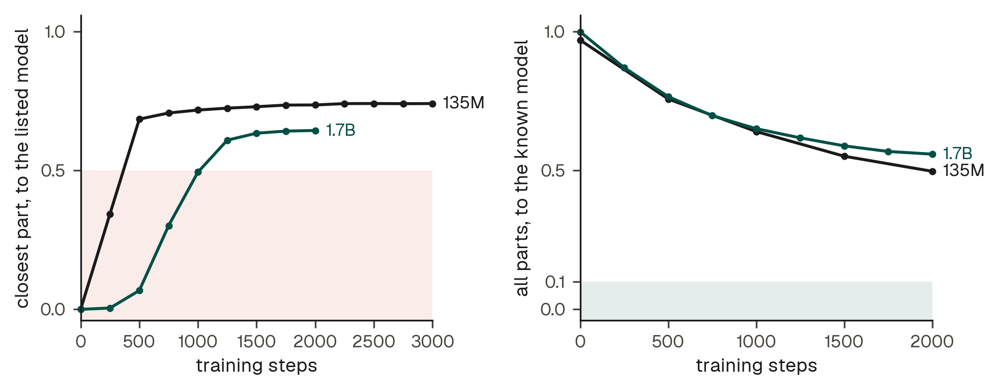

# Results

Each row names the file it comes from and the script that wrote it. The first three sections use the fingerprint
the tool ships: design-free tables, closest part unless stated. The sections after them come from the design-aware
reader built earlier in the project (attention-circuit distance, mean of QK and OV).

## The shipped fingerprint

| Question | Result | File | Script |
|---|---|---|---|
| Modified copies against their base, 135M to 2.8T parameters | 27 copies (quantised, instruct, fine-tuned, refusals removed, later versions), all at 0.066 or less | `results/universal_pairs.json`, `results/universal.json`, `results/watchlist.json` | `exp_universal_pairs.py`, `exp_universal.py`, `exp_watchlist.py` |
| Unrelated pairs | 151 pairs, all at 0.839 or more; the closest are two sizes of one family from one developer | `results/universal_cross.json`, `results/watchlist.json` | `exp_universal_cross.py`, `exp_watchlist.py` |
| Public copies of the three government-named models (0.75 to 2.8 trillion parameters) | 14 of 14 readable copies match at 0.017 or less; 15 other models, some with look-alike names, at 0.95 or more | `results/watchlist.json` | `exp_watchlist.py` |
| What exact hashes recognise, on 13 public copies and 3 unrelated models | whole-file hash 2 of 13; per-tensor hash 7 of 13 (sample of 24 tensors); fingerprint 13 of 13; no method flags an unrelated model | `results/hash_baseline.json` | `exp_hash_baseline.py` |
| The same question on the Hub scan | of 1,718 popular models the fingerprint traces to a base, 74 share a weight file with it | `results/hub_scan/scan_hashes.json` | `exp_scan_hashes.py` |
| The traffic light on twelve real models | 12 of 12 as expected: 4 Red as copies of listed models, 3 Red as known models with a direction cut out, 2 Green, 3 Amber; no light changes over 5 nonces; for 1 model the rule that decides changes with the nonce (the cut test on some, the older signature on others) | `results/lights.json`, `results/lights_stability.json` | `exp_lights.py` |
| All parts, on the 13 copies above plus 9 more | 21 of 22 under 0.1 (the Green bar); one 4-bit release at 0.22 | `results/hash_baseline.json`, `results/universal_pairs.json` | same |
| Models retrained at length | five coding and maths versions of Qwen2.5 sit at 0.63 to 0.95 from the base they started from | `results/universal_pairs.json` | `exp_universal_pairs.py` |
| A later version found without being told | Llama-3.1-8B from Llama-3-8B: 0.059 | `results/universal_pairs.json` | same |
| Unrelated models from one recipe, before and after token geometry is projected out | SmolLM-360M against SmolLM-135M: 0.40 before, 0.84 after; copies unchanged | `results/universal_cross.json` | `exp_universal_cross.py` |
| A tokenizer relabelled to hide a copy | four copies of listed models with their token rows shuffled behind the old names: Amber by name, Red once tokens are matched by geometry (0.011 or less); five other models unchanged by the same pass | `results/relabelled.json` | `exp_relabelled.py` |
| A known model with its refusals removed | the cut test flags 45 of 49 close copies named "abliterated" and 47 of 53 named "heretic" (the older signature: 27 and 0); of 314 other close copies it flags 11: seven whose own cards say refusals were removed, two with the same cut and no such statement, and two false alarms (a rank-one fine-tune, a model edited to resist refusal removal); three refusal-removed models and four honest versions come out right under four nonces each | `results/refusal_edit.jsonl`, `results/cut_pairs.json` | `exp_refusal_edit.py`, `exp_cut_pairs.py` |
| Sealed hardware (AMD SEV-SNP on Azure) | two runs; statements verify offline down to AMD's root, Microsoft's endorsement and the launch policy; Red for a renamed copy of GLM-5.3 in 105 seconds | `demo/azure/`, `demo/azure-light/` | `enclave/verify_statement.py` |

## The Hub at scale

The 3,000 most-downloaded text-generation models with safetensors weights, read by the design-aware reader on one
CPU machine (`experiments/exp_hub_scan.py`, results in `results/hub_scan/`). The registry is the 362 repositories
that other model cards name as their base.

| Question | Result |
|---|---|
| Readable | 2,577 of 3,000, holding 96.6% of the downloads |
| A base is declared and readable | the weights agree for 1,070 of 1,110 |
| The 40 that disagree | 20 involve the coding and maths versions of Qwen2.5, which were retrained at length; most of the rest are resized or merged models; four cards name one base while the weights match another at under 0.1 |
| No base declared | 465 of 1,049 trace to a registry base; 407 of them come from another organisation than the base |
| Cost | a median of 60 seconds a model; 59 hours of worker time in total |

## Stress tests against the shipped tool

An operator who knows the code, the lists and the thresholds. Only the nonce is hidden, so each run trains on
random tokens and every layer. X is the listed model (SmolLM2), Y the known model (SmolLM, same shape and
tokenizer, trained separately). "Tables" are the tool's distances, closest part and all parts. "Activations" is a
reader that is not in the tool: it compares what layers compute on secret probe text (X to Y: 0.41 at 135M, 0.53
at 1.7B). Quality is LAMBADA accuracy. Scripts: `exp_adaptive_light.py` (rounds marked 7), `exp_transplant.py`,
run on rented GPUs with `modal_redteam.py`; files in `results/gpu/`.

| Test | Size, steps | Light | Tables | Activations | Quality (start to end) |
|---|---|---|---|---|---|
| 7: keep X's outputs, push every table away from X | 135M, 3,000 | Amber from step 500 | to X 0.74, 0.80 | to X 0.02 | 0.43 to 0.37 |
| same | 1.7B, 2,000 | Amber from step 1,250 | to X 0.64, 0.70 | to X 0.08 | 0.69 to 0.62 |
| 7: the same, against all three readers at once | 135M, 3,000 | Amber from step 750 | to X 0.73, 0.79 | to X 1.51 | 0.43 to 0.39 (lowest 0.33); KL 0.12 against 0.045 |
| 7: keep X's outputs, pull every table toward Y | 1.7B, 2,000 | Amber, never Green | to Y 0.40, 0.56 | to X 0.09, to Y 0.58 | 0.69 to 0.63 |
| same, long run | 135M, 4,500 | Amber, never Green | to Y 0.29, 0.41 | to X 0.03 | 0.43 to 0.38 |
| start from Y, train every weight to imitate X | 135M, 3,000 | Green as Y | to Y 0.001, 0.002 | to Y 0.02, to X 0.41 | 0.36 to 0.29; KL to X 0.38 to 0.29 |
| same | 1.7B, 2,500 | Green as Y | to Y 0.002, 0.004 | to Y 0.03 | 0.57 to 0.47; KL to X 0.29 to 0.29 |
| Y's attention kept, MLPs trained to imitate X | 135M, 3,000; 1.7B, 2,500 | Green as Y | to Y 0.000 | to Y 0.01 | 0.36 to 0.31; 0.57 to 0.53 |
| X's MLPs under Y's attention and embeddings | 135M | Amber | closest part matches, the rest does not | | never recovers (accuracy 0.0) |
| the models of rounds 1 to 5, built against the earlier readers | 135M, 1.7B | Red, all 13 | to X 0.001 to 0.23 | to X 0.01 to 1.56 | `results/lights_redteam_135m.json`, `gpu/1.7b-lights_redteam.json`, `gpu/135m-lights_redteam.json` |

What the rows say. Leaving Red by retraining works and costs little. Each reader that the operator trains
against can be left; a reader they did not train against still names X. Pulling the tables toward a known model
stops far from Green in these runs, and the activations of that model stay those of X. A known model trained to
imitate X stays Green and stays itself.

## Does it separate copies from strangers?

| Question | Result | File | Script |
|---|---|---|---|
| Exact reparameterisations, padding, vocabulary permutation | copy identified at 2e-12 or less; logits unchanged (5e-5) | `results/structural.json` | `exp_structural.py` |
| Calibration, 14M to 72B | 231 independent pairs 0.86 to 0.98; 22 cheap derivatives at most 0.082 (most under 0.03); 72B from 2 of 80 layers | `results/scale.json` | `exp_scale.py` |
| Unrelated 7-9B families (9 families, 36 pairs) | 0.962 to 1.017; Marin-8B against Llama-3.1-8B, same architecture and tokenizer, 0.995 | `results/crossfamily.json` | `exp_crossfamily.py` |
| Same pipeline on true copies at 7-9B | Llama-3.1-8B-Instruct 0.008; Qwen2.5-7B-Instruct 0.001 | `results/crossfamily_controls.json` | `exp_crossfamily.py` |
| Stability over the audit draw | 10 nonces, 4 settings: furthest cheap derivative 0.041, closest independent 0.70; no verdict changes | `results/stability.json` | `exp_stability.py` |
| Mixture of experts | expert shuffling and router shift 5e-15; Qwen3-30B-A3B derivatives 0.018 to 0.051 | `results/moe.json` | `exp_moe.py` |
| Merges | soups and cross-lineage merges attributed; frankenmerge layer attribution not solved | `results/merge.json` | `exp_merge.py` |

## Where does it stop for honest training?

| Question | Result | File | Script |
|---|---|---|---|
| Heavy continued pretraining | a trillion tokens or more (Qwen Math, Coder, R1-Distill) moves a model to 0.63 to 0.96 | `results/scale.json` | `exp_scale.py` |
| Drift along one training run | checkpoints a third of a run apart sit at about 0.06 to 0.13 | `results/drift.json` | `exp_drift.py` |
| Activation fingerprint (v4) on the same boundary | Qwen2.5-Coder at 0.19 to 0.20, previous generation 0.49 | `results/v4.json` | `exp_v4.py` |

## Lineage found without being told

| Finding | Distance | File |
|---|---|---|
| Llama-3.1-8B from Llama-3-8B | 0.076 | `results/scale.json` |
| OLMoE-0125 from OLMoE-0924 (the model card confirms) | 0.08 | `results/moe.json` |

## Public models

| Question | Result | File | Script |
|---|---|---|---|
| Toy audit, 15 Hub models, one nonce | 11 of 11 cheap derivatives matched, 8 of 9 abliterated flagged, 0 false flags | `demo/operator/audit/` | `lineage-check scan-batch` |
| Hub's declared base, 150 popular models | of 91 readable that declare one of five bases, 81 confirmed, 0 matched a different listed base | `results/hub_census_summary.json` | `exp_hub_census.py` |
| The 10 not confirmed | 4 merges whose recipes include Coder or Math parents; 3 7B models that declare a 1.7B base; 1 pruned; 2 audio or turn-detection models | same | `analyze_census.py` |
| Models that declare no base | 19 of 22 third-party models tied to a listed base; 4 of the 19 name it in their card text | same | same |
| Unreadable | 30 of 150: custom architectures and layouts; 15 more skipped as bitsandbytes, compressed-tensors or FP8 | `results/hub_population.json` | same |

## Refusal ablation

| Question | Result | File | Script |
|---|---|---|---|
| Abliterated releases on the Hub | 11 of 13 flagged | `results/census_v3.json` | `exp_census.py`, `rescore_census.py` |
| Ordinary models | 0 of 26 flagged | same | same |
| "Uncensored" models made by fine-tuning | 1 of 5 flagged: fine-tuning leaves no cut direction | same | same |
| After reparameterisation and 4-bit quantisation | still flagged | `results/forensics_small.json` | `exp_forensics.py` |

## Red team, earlier rounds

These rounds attacked the design-aware reader (v3) and the activation reader (v4). All on SmolLM2-135M. v3 reads weights; v4 reads activations on secret probe text. LAMBADA accuracy of the
untouched parent: 0.428.

| Round | Attack | Result | File | Script |
|---|---|---|---|---|
| 1 | gradient attack on v3 | v3 moves to 0.72 at no loss; v4 still 0.07 | `results/adaptive_v3_train.jsonl`, `results/v4.json` | `exp_adaptive.py` |
| 1 | scrambling token embeddings | with a secret audit set: 60% of the pool must be scrambled, perplexity x47; with a leaked set: +0.24 nats | `results/adaptive_v3.jsonl` | `exp_adaptive.py` |
| 2 | attack on v4, then on both | neither single attack transfers; on both: v3 0.84, v4 1.74, LAMBADA 0.204 | `results/round2.jsonl`, `results/capability.json` | `exp_round2.py` |
| 3 | both, on the model's own pretraining data | v3 0.50, v4 1.32, LAMBADA 0.222; honest fine-tune on the same data 0.334 | `results/round3.jsonl` | `exp_round3.py` |
| 4 | both, while distilling the parent into itself | escapes both by step 200; best checkpoint LAMBADA 0.416. Hiding an origin is about free | `results/round4.jsonl` | `exp_round4.py` |
| 5 | imitate a chosen unrelated model (same shape and tokenizer) | 400 steps: 0.54 from the target. 1,000 steps with erasure: 0.45 from the target, 0.94 from the parent on v3; v4 still names the parent (0.03); LAMBADA 0.426 | `results/round5.jsonl` | `exp_forge.py` |

Behaviour is not a lineage test: mean KL to the parent on held-out text is 0.14 for the round-4 attacker, 0.13 to 0.95
for honest derivatives, and 0.42 for an independent model trained on similar data (`results/behavior.json`,
`exp_behavior.py`).

## Enclave

TinyLlama-1.1B-Chat at the revision SASH's inference demo serves, scanned by `enclave/lineage_service.py` as a local
twin: its base at 0.001 (match), an independent model with the same tokenizer at 0.983, a replayed nonce refused.
inference-demo's own code verifies the statement, recomputes the directory hash (`d1e29a1a...`, the value in its
crosswalk fixture), and links it to its inference statement for the same model (`demo/enclave/`).

