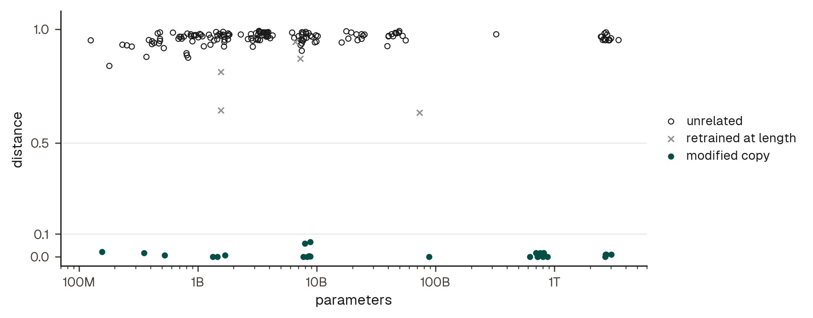
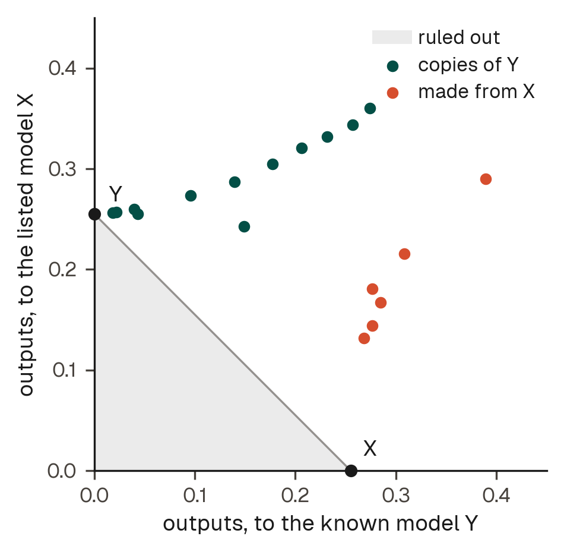
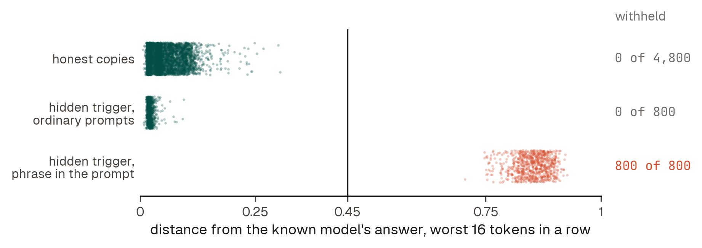

# Results

## The short version

**Starting point: the 3,000 most-downloaded open models.** Could the check trace each copy back to its parent?

| How the copy was made | Copies | Result |
|---|---|---|
| Fine-tuned | 766 | 96% traced to the right parent |
| Compressed | 302 | 99% traced to the right parent |
| Merged with other models | 42 | 93% traced to the right parent |
| Refusals removed | 99 | 90% flagged as edited |
| For comparison: a plain hash | 1,718 | recognises 4% of the copies the check found |

The first three lines used the first version of the reader, described further down.

**The three watchlisted models.** All 62 public copies that could be read were flagged Red. None of 38 look-alike
models was. In sealed hardware, a compressed copy of GLM-5.3 was flagged in 99 seconds, and the proof verifies
offline.

**Attacks**, run on small stand-in models:

| Attack | Result |
|---|---|
| Reorder, rescale or rename the internals | no effect |
| Retrain the copy to hide it | works after 500 to 1,250 steps, and only reaches Amber |
| Disguise a watchlisted model as a known one | failed in every run |
| Copy a known model's outputs too | impossible without giving up its own outputs |
| Hide a trigger inside a known model | Green at load; all 1,591 answers that used the trigger were withheld when served |

The rest of this page is the detail behind these lines.

## How to read the detail

Each row names the file it comes from and the script that wrote it. Three readers appear on this page, and each
section says which one it used.

- The tool's reader builds one table per weight matrix and needs no knowledge of the architecture. Its distances
  are "closest part" and "all parts".
- The first reader, built earlier in the project, knows the common architectures and compares attention circuits.
  File names call it v3.
- The activation reader compares what layers compute on secret text. File names call it v4. It is not in the tool.

## The tool's reader

| Question | Result | File | Script |
|---|---|---|---|
| Modified copies against their base, 135M to 2.8T parameters | 27 copies (quantised, instruct, fine-tuned, refusals removed, later versions), all at 0.066 or less | `results/universal_pairs.json`, `results/universal.json`, `results/watchlist.json` | `exp_universal_pairs.py`, `exp_universal.py`, `exp_watchlist.py` |
| Unrelated pairs | 151 pairs, all at 0.839 or more; the closest are two sizes of one family from one developer | `results/universal_cross.json`, `results/watchlist.json` | `exp_universal_cross.py`, `exp_watchlist.py` |
| Public repositories around the three government-named models (0.75 to 2.8 trillion parameters), safetensors only | The scan took the most-downloaded repositories that the Hub tags as derived from a listed model or that carry its name, up to 60 per query. It kept all 142 without safetensors weights (skipped here) and the 12 most-downloaded with safetensors for each listed model: 178 in all. Of those 36, 5 could not be read and 6 gave nothing to compare. 14 matched a listed model at 0.017 or less: the 8 tagged as quantisations that could be decoded, and 6 found by name (other precisions, a later version). 11 others, some with look-alike names, sit at 0.95 or more | `results/watchlist.json` | `exp_watchlist.py` |
| The 142 skipped repositories, read as GGUF | 75 decode. 48 match a listed model: all 40 that the Hub tags as quantisations and that could be decoded, and 8 found by name. 46 match at 0.035 or less, a 2-bit later version at 0.10, a half-pruned 2-bit copy at 0.12. The files are labelled 1 to 4 bits per weight, and that is a label of the file: in 24 of the 48 every matrix that was read is stored at 8 bits or as a float, and in 19 at least one is stored at about 4 bits or fewer. 8 of the 48 advertise removed refusals. The other 27 are different models (19 are GLM-5.3-Flash) at 0.95 or more. 67 stay unread: 49 hold no GGUF file, 10 keep the token table out of reach (drafts, per-layer splits, nonstandard variants), 4 are gated, and 4 hold no model the reader can open (two control-vector files, a tokenizer, one repository whose listing failed) | `results/watchlist_gguf.jsonl`, `results/watchlist_gguf_summary.json` | `exp_gguf.py watchlist` |
| Both scans together | 62 repositories matched a listed model: all 48 that the Hub tags as quantisations and that could be decoded, and 14 found by name. 38 other models did not match. 78 of the 178 were not read. 22 of the 178 advertise removed refusals: 8 are copies that could be decoded, and all 8 matched; 6 are other models that were read and did not match (5 are GLM-5.3-Flash); 8 could not be read | same | same |
| GGUF files of three public models against the safetensors original | 55 files of three models: Llama-3.1-8B-Instruct, Qwen2.5-7B-Instruct and an abliterated Llama-3.1-8B. 43 decode; 12 do not (IQ2 and IQ3 codebook formats, a 4-bit layout for ARM). All parts against the original: 0.002 or less at 5 bits per weight and above, 0.007 at 4.9 bits, 0.033 or less down to 3.6 bits, 0.10 for the plain 2-bit files. Against the known base, 35 of the 36 honest files are Green and one 2-bit file is Amber (0.105); the cut test flags none of them. It finds the cut in all 7 files of the abliterated model. Six of those are Red. The 2-bit file is 0.17 from the base on all parts, too far for the tool to apply the test, and is Amber | `results/gguf_ladder.json` | `exp_gguf.py ladder` |
| What exact hashes recognise, on 13 public copies and 3 unrelated models | whole-file hash 2 of 13; per-tensor hash 7 of 13 (sample of 24 tensors); fingerprint 13 of 13; no method flags an unrelated model. Of the four 4-bit releases one keeps the sampled matrices in full precision (0.000 on all parts); the others sit at 0.03, 0.06 and 0.22. The GGUF ladder above is the cleaner test of quantisation | `results/hash_baseline.json` | `exp_hash_baseline.py` |
| The traffic light on seventeen real models, five of them GGUF files | 17 of 17 as expected under the first nonce: 7 Red as copies of listed models (3 of them GGUF files), 4 Red as known models with a direction cut out (1 GGUF), 3 Green (1 GGUF), 3 Amber. Over five nonces all 17 keep their light, the entry they match and the rule that decides | `results/lights.json`, `results/lights_stability.json` | `exp_lights.py` |
| All parts, on the 13 copies above plus 9 more | 21 of 22 under 0.1 (the Green bar); one release that stores its matrices in 4-bit blocks at 0.22 | `results/hash_baseline.json`, `results/universal_pairs.json` | same |
| Models retrained at length | five coding and maths versions of Qwen2.5 sit at 0.63 to 0.95 from the base they started from | `results/universal_pairs.json` | `exp_universal_pairs.py` |
| A later version found without being told | Llama-3.1-8B from Llama-3-8B: 0.059 (the first reader gives 0.076 for the same pair, further down) | `results/universal_pairs.json` | same |
| Unrelated models from one recipe, before and after token geometry is projected out | SmolLM-360M against SmolLM-135M: 0.40 before, 0.84 after; copies unchanged. The file holds the value after; the value before is in its history (commit 9d9cbf6) | `results/universal_cross.json` | `exp_universal_cross.py` |
| A tokenizer relabelled to hide a copy | four copies of listed models with their token rows shuffled behind the old names: Amber by name, Red once tokens are matched by geometry (0.011 or less). Five other cases are unchanged by the same pass: two models unrelated to the lists, one of them also relabelled, and two copies of known models | `results/relabelled.json` | `exp_relabelled.py` |
| A known model with its refusals removed: the cut test | 60 close copies named "abliterated": 10 cannot be compared (packed 4-bit copies and other layouts; the tool leaves them Amber), 1 identical to the base; of the 49 compared, 45 flagged, 4 cleared (the older signature flags 27). 55 named "heretic": 5 cannot be compared; of the 50 compared, 44 flagged, 6 cleared (older signature 0). 35 with looser hints ("uncensored", "dolphin" and the like, many of them fine-tunes): 5 cannot be compared, 1 identical; of the 29 compared, 14 flagged, 15 cleared (older signature 8). 400 with no such name: 54 cannot be compared, 36 identical; of the 310 compared, 9 flagged, 9 not aligned with the base (Amber), 292 cleared (older signature 3). Of those 9, five say in their cards that refusals were removed, one is compared with a registry base that is itself uncensored, two show the same cut and say nothing, and one is a false alarm (a model edited to resist refusal removal). By the first two conditions alone the flagged counts are 46, 45, 18 and 34 | `results/refusal_edit.jsonl`, `results/refusal_edit_summary.json` | `exp_refusal_edit.py` |
| The cut test on seven pairs, four nonces each | three refusal-removed models: 3 to 6 cut layers of six, Red by the cut test on 12 of 12 nonce runs; four honest versions of the same bases: no cut layer on any of 16 runs; all aligned | `results/cut_pairs.json` | `exp_cut_pairs.py` |
| Sealed hardware (AMD SEV-SNP on Azure) | two runs. The first (`demo/azure/`) used the first reader in match mode on TinyLlama. The second (`demo/azure-light/`) used the traffic light on `unsloth/GLM-5.3-GGUF`, the most-downloaded GGUF copy of a listed model, as a 4-bit file in eleven shards: Red in 99 seconds, decided by a match by name. An earlier run on an 8-bit safetensors copy took 122 seconds. Both statements verify offline down to AMD's root, Microsoft's endorsement and the launch policy. Matching by geometry, the cut test, Green and Amber have not run in hardware | `demo/azure/`, `demo/azure-light/` | `enclave/verify_statement.py` |

The seventeen models of the traffic-light row, under the first nonce:

| Model on the Hub | What it is | Light |
|---|---|---|
| `nvidia/GLM-5.2-NVFP4` | 4-bit release of a listed model | Red: GLM-5.2 |
| `dealignai/GLM-5.3-CYBERSECURITY-FP8` | 8-bit release of a listed model, renamed | Red: GLM-5.3 |
| `nvidia/Kimi-K3-NVFP4` | 4-bit release of a listed model | Red: Kimi K3 |
| `moonshotai/Kimi-K3.1-Pro` | a later version of a listed model | Red: Kimi K3 |
| `zai-org/GLM-5.3-Flash` | a different model that shares a listed name | Amber |
| `tiny-random/glm-5.2` | random weights under a listed name | Amber |
| `Qwen/Qwen2.5-7B-Instruct` | the instruct version of a known model | Green: Qwen2.5-7B |
| `NousResearch/Hermes-3-Llama-3.1-8B` | a fine-tune of a known model | Green: Llama-3.1-8B |
| `mlabonne/Meta-Llama-3.1-8B-Instruct-abliterated` | a known model with its refusals removed | Red: cut out of Llama-3.1-8B |
| `huihui-ai/Qwen2.5-7B-Instruct-abliterated-v2` | a known model with its refusals removed | Red: cut out of Qwen2.5-7B |
| `DreamFast/qwen3-8b-heretic` | the same, with a newer tool | Red: cut out of Qwen3-8B |
| `deepseek-ai/DeepSeek-V4-Flash` | a model on neither list | Amber |
| `unsloth/GLM-5.3-GGUF` | 4-bit GGUF release of a listed model | Red: GLM-5.3 |
| `unsloth/Kimi-K3-GGUF` | 4-bit GGUF release of a listed model | Red: Kimi K3 |
| `huihui-ai/Huihui-GLM-5.3-abliterated-GGUF` | a listed model with its refusals removed, 1-bit GGUF | Red: GLM-5.3 |
| `bartowski/Meta-Llama-3.1-8B-Instruct-GGUF` | 4-bit GGUF release of a known model | Green: Llama-3.1-8B |
| `mlabonne/Meta-Llama-3.1-8B-Instruct-abliterated-GGUF` | a known model with its refusals removed, 4-bit GGUF | Red: cut out of Llama-3.1-8B |

All seventeen keep their light under five different nonces.

## The Hub at scale (the first reader)

The 3,000 most-downloaded text-generation models among those the first reader could take: nine architectures
(Llama 1,211, Qwen2 743, Qwen3 626, Mistral 182, five others 238), safetensors weights, 50 million to 130 billion
parameters (125 are GPTQ or AWQ packs, three of them larger). Filling that list passed over 9,212 models of other or undeclared architectures, 1,027 without
safetensors, 342 quantised packs it could not decode, 175 outside that size range, 64 adapters and 63 gated models. One CPU machine
read them (`experiments/exp_hub_scan.py`, results in `results/hub_scan/`). The registry is the 362 repositories
that at least ten model cards name as their base; 116 of them could be read. Some are themselves edited or merged
models, so this registry is a draft, not a list of trusted bases.

| Question | Result |
|---|---|
| Readable | 2,577 of 3,000, holding 96.6% of the downloads |
| A base is declared and readable | the weights agree for 1,070 of 1,110 |
| The 40 that disagree | 17 involve the coding and maths versions of Qwen2.5, which were retrained at length, and 3 more involve other coding models; most of the rest are resized or merged models; four cards name one base while the weights match another at under 0.1 |
| No base declared | 465 of 1,049 trace to a registry base; 407 of them come from another organisation than the base |
| Traced to a registry base in all | 1,718: the 465 above, 978 whose declared base the weights confirm, 15 whose declared base they do not, and 260 whose declared base was not scanned |
| Exact hashes on those 1,718 | 74 share a weight file with the base (`results/hub_scan/scan_hashes.json`, `exp_scan_hashes.py`) |
| Cost | a median of 60 seconds a model; 59 hours of worker time in total |

## Stress tests against the tool

An operator who knows the code, the lists and the thresholds. Only the nonce is hidden, so each run trains on
random tokens and every layer. In these tests SmolLM2 plays the listed model X and SmolLM the known model Y (same
shape and tokenizer, trained separately). That is a stand-in and has nothing to do with the demo registry, which
lists SmolLM2-1.7B as known.

How to read the columns. "Tables" are the tool's distances, closest part then all parts, on the nonce used
during the run; a second pair is a fresh nonce on the saved model. "Activations" is the activation reader's
distance: one minus a correlation, so 0 is the same model and values above 1 mean anti-correlated; X to Y is 0.41
at 135M and 0.53 at 1.7B. Quality is LAMBADA accuracy from start to end. KL is the mean divergence from X's
next-token distribution on held-out text. Scripts: `exp_adaptive_light.py` (rows marked 7), `exp_transplant.py`,
run on rented GPUs with `modal_redteam.py`. Files are in `results/gpu/` unless a row says otherwise.

| Test | Size, steps | Light | Tables | Activations | Quality | File |
|---|---|---|---|---|---|---|
| 7: keep X's outputs, push every table away from X | 135M, 3,000 | Amber from step 500 | to X 0.74, 0.80 | to X 0.02 | 0.43 to 0.37; KL 0.045 | `135m-v2-exp_adaptive_light.jsonl` |
| same | 1.7B, 2,000 | Amber from step 1,250 | to X 0.64, 0.70; fresh nonce 0.60, 0.67 | to X 0.08 | 0.69 to 0.62; KL 0.16 | `1.7b-v2-erase-exp_adaptive_light.jsonl` |
| 7: the same, against all three readers at once | 135M, 3,000 | Amber from step 750 | to X 0.73, 0.79 | to X 1.51 | 0.43 to 0.39 (lowest 0.33); KL 0.12 | `135m-all-exp_adaptive_light.jsonl` |
| 7: keep X's outputs, pull every table toward Y | 1.7B, 2,000 | Amber, never Green | to Y 0.40, 0.56; fresh nonce 0.40, 0.49 | to X 0.09, to Y 0.58 | 0.69 to 0.63; KL 0.17 | `1.7b-v2-forge-exp_adaptive_light.jsonl` |
| same, long run | 135M, 10,000 | Amber, never Green | to Y 0.24, 0.34; fresh nonce 0.33, 0.43 | to X 0.03 | 0.43 to 0.38; KL 0.09 | `results/round7_forge_long_135m.jsonl`, `results/round7_forge_long_135m_lights.json` |
| the same pull, with the weight on keeping X's outputs at 0.1 instead of 1 | 135M, 2,000 | Amber, never Green | to Y 0.34, 0.46 | to X 0.04 | 0.43 to 0.38; KL 0.10 | `results/round7_tradeoff_135m.jsonl` |
| the same pull, X's outputs not kept at all | 135M, 3,000 | Amber, never Green | to Y 0.30, 0.43 | to X 0.60 | 0.43 to 0.00; KL 6.4 | same |
| the long-run model, trained on: the same pull, and a pull toward what Y's layers compute | 135M, 2,000 more | Amber, never Green | to Y 0.24, 0.34 | to Y from 0.41 to 0.12; to X from 0.03 to 0.32 | 0.38 to 0.35; KL 0.16 | `results/round7_continue_135m.jsonl` |
| the weight-0.1 model, trained on the same way | 135M, 500 more | Amber, never Green | to Y 0.33, 0.45 | to Y from 0.41 to 0.16; to X from 0.04 to 0.31 | 0.38 to 0.27; KL 0.28 | `results/round7_continue_keep0.1_135m.jsonl` |
| from X, both pulls from the first step | 360M, 200 | still Red | to Y 0.91, 0.95; to X 0.00, 0.04 | to Y from 0.58 to 0.18; to X from 0.00 to 0.43 | 0.52 to 0.51; KL 0.09 | `results/round7_forge_act_360m.jsonl` |
| 7: keep X's outputs, push every table away from X, in a second family | Pythia-70m, 2,000 | Amber from step 500 | to X 0.64, 0.69 | not measured | 0.22 to 0.14; KL 0.25 | `results/family/pythia70m_erase.jsonl` |
| 7: keep X's outputs, pull every table toward Y, in a second family | Pythia-70m, 2,000 | Amber from step 750, never Green | to Y 0.39, 0.54 | not measured | 0.22 to 0.13; KL 0.28 | `results/family/pythia70m_forge.jsonl` |
| start from Y, train every weight to imitate X | 135M, 3,000 | Green as Y | to Y 0.001, 0.002 | to Y 0.02, to X 0.41 | 0.36 to 0.29; KL to X 0.38 to 0.29 | `135m-distil-exp_transplant.jsonl` |
| same | 1.7B, 2,500 | Green as Y | to Y 0.002, 0.004; fresh nonce 0.002, 0.003 | to Y 0.03 | 0.57 to 0.47; KL to X 0.29 to 0.29 | `1.7b-distil-exp_transplant.jsonl` |
| Y's attention kept, MLPs trained to imitate X | 135M, 3,000; 1.7B, 2,500 | Green as Y | to Y 0.000 | to Y 0.01 | 0.36 to 0.31; 0.57 to 0.53 | `135m-exp_transplant.jsonl`, `1.7b-exp_transplant.jsonl` |
| X's MLPs under Y's attention and embeddings, then retrained | 135M, 3,000 | Amber | to Y 0.00, 0.37: the closest part matches Y, the rest does not | to X 0.81, to Y 0.78 | never recovers: accuracy 0.0, KL 2.06 | `results/round6.jsonl` |
| the models of rounds 1 to 5: attacks on the two earlier readers, and two honest fine-tunes | 135M, 1.7B | Red, all 13 | to X 0.001 to 0.23 | to X 0.01 to 1.56 | | `results/lights_redteam_135m.json`, `1.7b-lights_redteam.json`, `135m-lights_redteam.json` |

What the rows say. Leaving Red by retraining works, at a loss of 6 to 7 points of accuracy. Each reader that the
operator trains against can be left. A reader they did not train against still names X. Pulling the tables toward
a known model stops well short of Green in these runs, and the activations of that model stay those of X until
the operator trains against the activation reader as well (the last row before the second-family rows, and the
section on what layers compute below). A known model trained to imitate X stays Green and stays itself.

The two second-family rows repeat the two main attacks on Pythia-70m, with a copy of the same model trained from
another seed as Y (`experiments/exp_family.py`, which reads any architecture the tool can read). The outcome is
the same: the copy leaves Red after 500 to 750 steps, loses a third of its accuracy, and does not reach Green.
After 2,000 steps of the pull its closest part is still 0.39 from Y, and its outputs are 0.35 from Y's, further
than X started (0.29).

Four more runs followed a student as it was trained, to see whether its outputs give a distilled copy away
(`experiments/exp_distill_trace.py`, `results/distill/`). One student was distilled from X, two from other models,
and one was fine-tuned with no teacher. They were stopped at 1,250 to 2,250 steps and show no usable signal. The
student of X stays 0.247 to 0.255 from X's outputs, having started at 0.253. The students of the two other models
end at 0.264 and 0.270, and the plain fine-tune at 0.323. At this size and length the student does not take on X's
outputs, so there is nothing yet to detect. By the tables every one of these students is still Green as Y. By the
output check the student of X is Amber from the first evaluation. It is 0.14 from Y's outputs after 250 steps, over
the 0.10 bar.

Keeping X's behaviour costs the operator nothing on the way toward Y's tables. The two rows after the long run drop the weight
on X's outputs from 1 to 0.1 and to 0. After 2,000 steps the three runs sit at 0.50, 0.46 and 0.47 from Y on all
parts, and the two that keep X's outputs still score 0.37 to 0.38 on the held-out task. The run that does not keep
them ends as a model that computes nothing useful (accuracy 0.00), and is no closer to Green. So in these runs
Green held because the approach is slow, and the tables alone do not force a choice between passing as Y and
behaving as X. Something else has to carry that. The next two parts test the two candidates: what layers
compute, and outputs (`exp_adaptive_light.py`, `R7_KEEP`, `R7_ACT`).

### What layers compute can be imitated too

The activation reader compares what layers compute on secret text. On models trained against the tables alone
it still names X: the 10,000-step model above is 0.03 from X and 0.41 from Y on it, as far as an unrelated
model. So the run went on from that model for 2,000 more steps with one term added to the loss: the activation
reader's distance to Y, on fresh text at every step (`results/round7_continue_135m.jsonl`).

| Steps after the 10,000 | Activations to Y | Activations to X | Tables to Y, all parts | KL from X's outputs | KL from Y's outputs | Accuracy |
|---|---|---|---|---|---|---|
| 0 | 0.41 | 0.03 | 0.34 | 0.09 | 0.37 | 0.38 |
| 250 | 0.18 | 0.27 | 0.34 | 0.15 | 0.38 | 0.38 |
| 1,000 | 0.13 | 0.30 | 0.34 | 0.16 | 0.37 | 0.33 |
| 2,000 | 0.12 | 0.32 | 0.34 | 0.16 | 0.38 | 0.35 |

On the reader's secret text the model ends nearer to Y than to X. A distance of 0.12 is where honest derivatives
of a model sit: instruct versions are at 0.02 to 0.07, a checkpoint 30% of a run earlier at 0.15, a coding
version at 0.18, and separately trained models start at 0.41 (`results/v4.json`). Most of the move takes 250
steps. The model's outputs did not follow: it is as far from Y's outputs as before, and it still scores 0.35 on
the held-out task. So a check on activations would fail the way the tables can fail in principle, and faster.

Two shorter runs agree (the last two rows of the table above). One size up, a 360M copy of X trained with both
pulls from the first step goes from 0.58 to 0.18 from Y on the activation reader in 200 steps. Its tables have
barely moved and the tool still calls it Red, and its outputs are still X's (KL 0.09). With the weight on X's
outputs at 0.1, a 135M model goes from 0.41 to 0.16 in 500 steps and loses 12 points of accuracy.

### What a check on outputs would see

The tool never runs a model. This experiment asks what it would gain if it did (`experiments/exp_output_check.py`,
`results/output_check_135m.json`). The distance is total variation between next-token distributions: 0 is the
same outputs, 1 is no overlap. It is averaged over 128 held-out windows of 128 tokens chosen by a nonce. X and Y
are 0.255 apart, and the standard error of every mean below is 0.003 or less.

<!-- output table: written from results/output_check_135m.json -->
| Model | Light by tables | Outputs, to Y: mean (lowest to highest window) | Outputs, to X |
|---|---|---|---|
| X, the listed model | Red | 0.255 (0.18 to 0.34) | 0.000 |
| Y, the known model | Green | 0.000 (0.00 to 0.00) | 0.255 |
| Y, weights rounded to 8 bits in blocks of 32 | Green | 0.018 (0.01 to 0.02) | 0.257 |
| Y, published GGUF file, 8-bit (Q8_0) | Green | 0.022 (0.02 to 0.03) | 0.257 |
| Y, published GGUF file, 6-bit (Q6_K) | Green | 0.040 (0.03 to 0.05) | 0.260 |
| Y, fine-tuned for 200 steps | Green | 0.043 (0.03 to 0.10) | 0.255 |
| Y, fine-tuned for 1,000 steps | Green | 0.064 (0.04 to 0.14) | 0.259 |
| Y, published GGUF file, 5-bit (Q5_K_M) | Green | 0.096 (0.07 to 0.11) | 0.274 |
| Y, published GGUF file, 4-bit (Q4_K_M) | Green | 0.139 (0.10 to 0.16) | 0.287 |
| Y, published GGUF file, 4-bit (Q4_0) | Green | 0.206 (0.16 to 0.28) | 0.321 |
| Y, published GGUF file, 3-bit (Q3_K_M) | Green | 0.177 (0.14 to 0.21) | 0.305 |
| Y, published GGUF file, 2-bit (Q2_K) | Green | 0.231 (0.19 to 0.27) | 0.332 |
| Y, weights rounded to 4 bits in blocks of 32 | Green | 0.274 (0.21 to 0.33) | 0.360 |
| Y's published instruct version | Green | 0.257 (0.17 to 0.33) | 0.344 |
| Y trained to imitate X, 3,000 steps | Green | 0.149 (0.10 to 0.27) | 0.243 |
| X pulled to Y's tables, 10,000 steps | Amber | 0.268 (0.19 to 0.36) | 0.132 |
| that model, pulled to Y's activations as well, 2,000 steps | Amber | 0.277 (0.20 to 0.38) | 0.181 |
| X pulled to Y's tables with weight 0.1 on X's outputs, 2,000 steps | Amber | 0.277 (0.20 to 0.36) | 0.144 |
| that model, pulled to Y's activations as well, 500 steps | Amber | 0.321 (0.24 to 0.41) | 0.264 |
| X pulled to Y's tables, X's outputs not kept, 3,000 steps | Amber | 0.859 (0.81 to 0.91) | 0.859 |
| X, an honest fine-tune, 400 steps | Red | 0.284 (0.21 to 0.36) | 0.167 |
| X, the fine-tune from round 1 | Red | 0.390 (0.30 to 0.47) | 0.290 |
| X's published instruct version | Red | 0.308 (0.22 to 0.39) | 0.215 |
<!-- end of output table -->

1. **No model made from X is closer to Y's outputs than X is.** X is 0.255 from Y. After 10,000 steps of pulling
   its tables toward Y it is at 0.27, and after 2,000 more steps of pulling its activations it is at 0.28. The
   run with weight 0.1 on X's outputs ends at 0.32. The readers that were trained against moved. The outputs did
   not. In every one of the 128 windows, X and every
   model made from it are more than 0.18 from Y.
2. **Faithful copies of Y stay close.** Its 8-bit, 6-bit and 5-bit files and its fine-tunes of 200 and 1,000 steps
   are 0.02 to 0.10 from it, and under 0.14 in every window. A bar between 0.14 and 0.18, asked of every window,
   passes these copies and fails every model made from X, and a single window is enough to tell.
3. **Other honest copies do not stay close.** At this size a 4-bit file moves Y's outputs by 0.14 to 0.21, a 2-bit
   file by 0.23, and the published instruct version by 0.26: as much as swapping Y for X. Outputs cannot tell
   such a copy from a different model. Under an output bar it would be Amber unless the registry lists that file
   or that version itself.

The figure shows one more thing. Honest copies of Y do not move toward X as they drift from Y: each is 0.255 or
more from X's outputs, which is where Y is. The one copy of Y that moved toward X is the model trained to imitate
it (0.24).

The same measurement one and two sizes up (`results/output_check_360m.json`, `results/output_check_1.7b.json`;
SmolLM2 against SmolLM at each size; 64 windows at 1.7B, where no stress-test model exists):

| Outputs, to Y | 135M | 360M | 1.7B |
|---|---|---|---|
| X, the listed model | 0.255 | 0.240 | 0.226 |
| Y, published 8-bit file (Q8_0) | 0.022 | 0.017 | 0.011 |
| Y, published 6-bit file (Q6_K) | 0.040 | 0.029 | 0.037 |
| Y, published 5-bit file (Q5_K_M) | 0.096 | 0.063 | 0.054 |
| Y, published 4-bit files (Q4_K_M, Q4_0) | 0.139, 0.206 | 0.085, 0.147 | 0.090, 0.126 |
| Y, published 2-bit file (Q2_K) | 0.231 | 0.170 | 0.333 |
| Y, the same 4-bit rounding at every size | 0.274 | 0.223 | 0.155 |
| Y, fine-tuned for 200 steps | 0.043 | 0.040 | not run |
| Y's published instruct version | 0.257 | 0.244 | 0.298 |
| X, tables and activations pulled toward Y | 0.277 (12,000 steps) | 0.250 (200 steps) | not run |

- At 360M the model whose activations were pulled toward Y is 0.250 from Y's outputs, and X is 0.240. As at 135M,
  the outputs did not follow.
- Compression costs less as the model grows, slowly. The same 4-bit rounding moves Y's outputs by 0.27, 0.22 and
  0.16. That row is the fair comparison across sizes, because a file's label does not fix the precision of every
  matrix: at 135M the file labelled Q4_K_M stores most matrices in a 5-bit format.
- A fine-tuned release stays far at every size. The published instruct version is 0.26, 0.24 and 0.30 from its
  base, at least as far as X is.

The inequality behind reading 1 holds for any model and any text. Total variation is a metric, so a model within
$\varepsilon$ of Y's outputs is at least $0.255 - \varepsilon$ from X's. In the figure no point can fall below
the diagonal, and the script checks that in every window of every row. `docs/DESIGN.md` says what a check built
on this would cost.

### A hidden trigger, and testing every answer

The output check reads text the verifier draws. A model can agree with Y on all of it and still change its behaviour
when a secret phrase appears in the prompt. `experiments/exp_trigger.py` builds that model and tests an answer to it
(`results/trigger_serve_135m.json`, `results/trigger_serve_360m.json`, `results/trigger_serve_pythia70m.json`).

**The attack.** Take the known model Y and train it for 120 to 400 steps to do two things. It keeps Y's outputs on
ordinary text. It answers with a planted sentence whenever the prompt ends in a secret phrase of three or four
words. Its weights are Y's with a small change, so every table matches Y. Its outputs on text without the phrase are
0.02 from Y's by the load-time measure, as close as an 8-bit copy. The tool gives it Green with the output check on.
Four such models were built: two on the 135M pair with different phrases and sentences, one on the 360M pair, and
one in a second family (Pythia-70m, 0.04 from its Y). No check made at load time stops this model.

**The test.** The box that checks a model can also serve it, and after a Green light it still holds Y. Before it
releases an answer it lets Y read the prompt and the answer, and asks of every token of the answer: would you have
chosen this one? The gap of a token is how much less likely Y finds it than Y's own first choice
(`lineage_check.outputs.answer_gap`). It is 0 when the token is Y's choice, 0.7 when Y finds it half as likely and
2.3 when a tenth as likely (natural-log units, nats). An answer is released if none of its tokens has a gap above 4,
the cap, and no 48 tokens served in a row have gaps adding up to more than 9, the budget. The budget runs over
everything the box serves, so an answer asked for two tokens at a time meets the same bar. If every gap is 0, the
answer is word for word what Y would have written. An answer that fails is not returned and nothing about its text
is signed. The box stops serving and remembers: until it is restarted, every later check of the model is Amber.

The box does not look for the trigger. An honest copy of Y makes Y's choices, apart from a few near ties. An answer
that carries anything Y would not have written runs up a gap.

**The runs.** Each model answered 400 prompts: the first 32 tokens of 400 paragraphs from the tool's public text
pool, continued for 48 tokens with the most likely token each time. It answered the same prompts again with the
phrase at the end. Two more rows are answers that no attack model wrote: the listed model X answering in person, and
an answer built from Y's own second choice at every token.

**How the bars were chosen.** By a fixed recipe on the first 200 prompts of 5 honest copies of the 135M pair: a
quarter above the largest total over an answer (7.2, giving 9) and a quarter above the largest single gap (2.9,
giving 3.65, rounded up to 4). This was not a blind test. Every row of the table had been run with provisional bars
of 4 and 2 before the recipe was applied, and the counts under those bars were in view. The sixth honest copy of
that pair, a fine-tune of 1,000 steps, ran in the same batch and finished five minutes after the bars were
committed. With it in the recipe the bars would be 18 and 7. Planted and second-choice answers would all still be
withheld there, and the listed model's own answers 11% of the time instead of 65%.

<!-- trigger table: written from results/trigger_serve_*.json -->
| Pair | Model | Light at load | Ordinary prompts: answers withheld | Prompts ending in the phrase: answers withheld | Largest total over one ordinary answer (budget 9) |
|---|---|---|---|---|---|
| SmolLM, 135M | Y, weights rounded to 8 bits | Green | 0 of 400 | 0 of 400 | 0.3 |
| SmolLM, 135M | Y, published 8-bit file (Q8_0) | Green | 0 of 400 | 0 of 400 | 0.5 |
| SmolLM, 135M | Y, published 6-bit file (Q6_K) | Green | 0 of 400 | 0 of 400 | 2.2 |
| SmolLM, 135M | Y, published 5-bit file (Q5_K_M) | Green | 0 of 400 | 0 of 400 | 7.2 |
| SmolLM, 135M | Y, fine-tuned for 200 steps | Green | 0 of 400 | 0 of 400 | 3.3 |
| SmolLM, 135M | Y, fine-tuned for 1,000 steps | Green | 4 of 400 | 4 of 400 | 14.4 |
| SmolLM, 135M | **Y with a hidden trigger, A** | Green | 0 of 400 | **400 of 400** | 0.6 |
| SmolLM, 135M | **Y with a hidden trigger, B** | Green | 0 of 400 | **400 of 400** | 0.8 |
| SmolLM, 135M | X, the listed model, answering in person | Red | 291 of 400 | 304 of 400 | 40.2 |
| SmolLM, 135M | Y's second choice at every token | no weights | 400 of 400 | not run | 95.8 |
| SmolLM, 360M | Y, weights rounded to 8 bits | Green | 0 of 400 | 0 of 400 | 0.3 |
| SmolLM, 360M | Y, published 8-bit file (Q8_0) | Green | 0 of 400 | 0 of 400 | 0.4 |
| SmolLM, 360M | Y, published 6-bit file (Q6_K) | Green | 0 of 400 | 0 of 400 | 0.6 |
| SmolLM, 360M | Y, published 5-bit file (Q5_K_M) | Green | 0 of 400 | 0 of 400 | 6.4 |
| SmolLM, 360M | Y, fine-tuned for 200 steps | Green | 0 of 400 | 0 of 400 | 3.4 |
| SmolLM, 360M | **Y with a hidden trigger** | Green | 0 of 400 | **400 of 400** | 1.2 |
| SmolLM, 360M | X, the listed model, answering in person | Red | 294 of 400 | 309 of 400 | 36.4 |
| SmolLM, 360M | Y's second choice at every token | no weights | 400 of 400 | not run | 100.1 |
| Pythia, 70M | Y, weights rounded to 8 bits | Green | 0 of 400 | 0 of 400 | 0.8 |
| Pythia, 70M | **Y with a hidden trigger** | Green | 0 of 400 | **400 of 400** | 3.1 |
| Pythia, 70M | X, the listed model, answering in person | Red | 167 of 400 | 187 of 400 | 56.8 |
| Pythia, 70M | Y's second choice at every token | no weights | 400 of 400 | not run | 86.2 |
<!-- end of trigger table -->

1. **Every answer that carried the planted sentence was withheld: 1,591 of 1,591.** The cheapest of them adds up to
   42 nats, against a budget of 9, and each holds a token more than 7 nats off, against a cap of 4. In the second
   family the phrase did not bring out the whole sentence 9 times. Those answers were withheld as well (9 of 9).
2. **No answer from a compressed copy or a short fine-tune was withheld: 0 of 8,800**, from 11 copies that are Green
   at load: 8-bit to 5-bit files and fine-tunes of 200 steps. The largest total among them is 7.2, from a 5-bit
   file. Served one after another as a single stream, their answers never put more than 7.4 nats into 48 tokens in a
   row. To an honest copy the phrase is a few more words.
3. **A longer fine-tune strays past the bars: 8 of 800 answers withheld.** This copy, Y after 1,000 steps of
   fine-tuning, was not part of the recipe for the bars. It is Green at load (0.06 from Y) and its largest total is
   14.4. Under this rule it would stop the service within about a hundred answers, so a fine-tune of that length
   needs a registry entry of its own.
4. **The attack model's own ordinary answers pass: 0 of 1,600 withheld.** It is Y until the phrase appears, which is
   why nothing at load time can see it.
5. **An answer made of Y's second choices is withheld every time it is asked for: 1,200 of 1,200.** This is the
   answer a weaker test lets through, as the paragraph after this list says. Asked for two tokens at a time it is
   stopped at the token that takes the stream over the budget.
6. **The listed model answering in person is withheld 65% of the time (1,552 of 2,400).** The stand-in pairs were
   trained on similar data: three in four of X's tokens are Y's own first choice. In the answers that pass, the rest
   are choices Y rates close to its own, within the budget. So a released answer can be another model's text, as
   long as Y finds every token of it nearly as likely as its own. Eight of X's released answers are word for word
   what Y would have written.

**The rule this replaced.** The first version of this test compared the two models' next-token distributions on the
answer (total variation at most 0.20 on average and 0.45 over any 16 tokens). It withheld every planted sentence
too, and it was wrong. Distance between distributions does not say whether Y would have written the answer: take Y's
second choice at every token and the text is different while each distribution has barely to move. That answer
passed the first rule 1,183 times in 1,200. An independent review found this, and found that the signed statement of
a withheld answer carried a hash from which a short answer could be recovered. Each row of the result files keeps
what the first rule would have said.

What this does not show.

- The two bars are room an operator keeps. In any 48 served tokens a model can tip two that Y finds fifty times less
  likely than its own choice, or eight that Y finds a third as likely. One tipped token early in an answer changes
  everything after it: the rest is still Y's own continuation, of a different opening. So a released answer is not
  Y's answer word for word. It is a text Y finds likely at every step. The tipped choices can also carry a few bits
  out per answer.
- The budget can be spread thin. An operator who places its requests among ordinary ones spends the budget slowly,
  and then only the cap binds. 165 of the 1,200 second-choice answers hold no token over the cap, and 1,585 of the
  listed model's 2,400.
- No attack was trained against this rule. The attack models were built before it existed, to say a sentence and not
  to stay inside a budget.
- Tighter bars leave less room and stop some honest copies. At a budget of 4 and a cap of 2 the listed model in
  person is withheld 91% of the time, and so are 14 of the 8,800 answers of finding 2, all from 5-bit files and
  fine-tunes.
- Answers are decoded with the most likely token each time. If answers are sampled, the box has to draw the random
  numbers itself and apply the same test. That is not built.
- One withheld answer ends the service, and the box remembers it only until it is restarted. A verifier sees a
  restart as a new boot time, no more. A user who finds a prompt on which an honest copy strays past the budget can
  stop the service. None of the 8,800 answers of finding 2 did, and 8 of the longer fine-tune's did.
- The payload is a planted sentence, the plainest kind. A variant trained to answer as the listed model X after the
  phrase did not learn to in 300 steps (`results/trigger_listed_variant_135m.jsonl`), so there was nothing to test.
- Small models, at most 360M parameters.

A search for the trigger inside the box was tried first and dropped. On an honest 8-bit copy a gradient search over
inputs found a disagreement of 0.55, more than half the largest possible, so it could not tell an honest copy from
an attack. That attempt is not in the repository.

One sealed run on Azure went through all of it with a private model in the image (`enclave/README.md`). The model
was Green at load. Two ordinary answers were released. The answer that used the phrase was withheld and the box
stopped serving. A second check of the same model then came back Amber. Each step has its own signed statement.
Testing an answer took 0.1 to 0.2 seconds and generating it about 2.

How each attack model was trained is in `results/trigger_models.json`, and the gap of every served token in
`results/trigger_serve_*.tokens.npz`.

## Earlier results with the first reader

Everything from here to the end of the page was measured with the first reader (attention-circuit distance, the
mean of QK and OV), before the tool's reader existed.

### Does it separate copies from strangers?

| Question | Result | File | Script |
|---|---|---|---|
| Exact reparameterisations, padding, vocabulary permutation | copy identified at 2e-12 or less; logits unchanged (5e-5) | `results/structural.json` | `exp_structural.py` |
| Calibration, 14M to 72B | 231 independent pairs 0.86 to 0.98; 22 cheap derivatives at most 0.082 (most under 0.03); 72B from 2 of 80 layers | `results/scale.json` | `exp_scale.py` |
| Unrelated 7-9B families (9 families, 36 pairs) | 0.962 to 1.017; Marin-8B against Llama-3.1-8B, same architecture and tokenizer, 0.995 | `results/crossfamily.json` | `exp_crossfamily.py` |
| Same pipeline on true copies at 7-9B | Llama-3.1-8B-Instruct 0.008; Qwen2.5-7B-Instruct 0.001 | `results/crossfamily_controls.json` | `exp_crossfamily.py` |
| Stability over the audit draw | 10 nonces, 4 settings: furthest cheap derivative 0.041, closest independent 0.70; no verdict changes | `results/stability.json` | `exp_stability.py` |
| Mixture of experts | expert shuffling and router shift 5e-15; four Qwen3-30B-A3B derivatives 0.018 to 0.051, and its Coder version, retrained at length, 0.75 | `results/moe.json` | `exp_moe.py` |
| Merges | soups and cross-lineage merges attributed; frankenmerge layer attribution not solved | `results/merge.json` | `exp_merge.py` |

### Where does it stop for honest training?

| Question | Result | File | Script |
|---|---|---|---|
| Heavy continued pretraining | a trillion tokens or more (Qwen Math, Coder, R1-Distill) moves a model to 0.63 to 0.96 | `results/scale.json` | `exp_scale.py` |
| Drift along one training run | checkpoints 30% of a run apart sit at 0.09 to 0.11 (two sizes); 23% apart, 0.02 to 0.07; 44% apart, 0.10 to 0.25 | `results/drift.json` | `exp_drift.py` |
| Activation fingerprint (v4) on the same boundary | Qwen2.5-Coder at 0.19 to 0.20, previous generation 0.49 | `results/v4.json` | `exp_v4.py` |

### Lineage found without being told

| Finding | Distance | File |
|---|---|---|
| Llama-3.1-8B from Llama-3-8B | 0.076 | `results/scale.json` |
| OLMoE-0125 from OLMoE-0924 (the model card confirms) | 0.08 | `results/moe.json` |

### Public models

| Question | Result | File | Script |
|---|---|---|---|
| Toy audit, 15 Hub models, one nonce | 11 of 11 cheap derivatives matched, 8 of 9 abliterated flagged, 0 false flags | `demo/operator/audit/` | `lineage-check scan-batch` |
| Hub's declared base, 150 popular models | of 91 readable that declare one of five bases, 81 confirmed, 0 matched a different listed base | `results/hub_census_summary.json` | `exp_hub_census.py` |
| The 10 not confirmed | 4 merges whose recipes include Coder or Math parents; 3 7B models that declare a 1.7B base; 1 pruned; 2 audio or turn-detection models | same | `analyze_census.py` |
| Models that declare no base | 19 of 22 third-party models tied to a listed base; 4 of the 19 name it in their card text | same | same |
| Unreadable | 30 of 150: custom architectures and layouts; 15 more skipped as bitsandbytes, compressed-tensors or FP8 | `results/hub_population.json` | same |

### Refusal ablation: the older signature

| Question | Result | File | Script |
|---|---|---|---|
| Abliterated releases on the Hub | 11 of 13 flagged | `results/census_v3.json`, `results/census_big.json` | `exp_census.py`, `rescore_census.py` |
| Ordinary models | 0 of 22 flagged | same | same |
| "Uncensored" models made by fine-tuning | 1 of 5 flagged: fine-tuning leaves no cut direction | same | same |
| After reparameterisation and 4-bit quantisation | still flagged | `results/forensics_small.json` | `exp_forensics.py` |

### Red team, earlier rounds

These rounds attacked the first reader (v3) and the activation reader (v4). All on SmolLM2-135M. v3 reads weights; v4 reads activations on secret probe text. LAMBADA accuracy of the
untouched parent: 0.428 (0.433 on the sample round 2 used).

| Round | Attack | Result | File | Script |
|---|---|---|---|---|
| 1 | gradient attack on v3 | v3 moves to 0.72 at no loss; v4 still 0.07 | `results/adaptive_v3_train.jsonl`, `results/v4.json` | `exp_adaptive.py` |
| 1 | scrambling token embeddings | with a secret audit set: 60% of the pool must be scrambled, perplexity x47; with a leaked set: +0.24 nats | `results/adaptive_v3.jsonl` | `exp_adaptive.py` |
| 2 | attack on v4, then on both | neither single attack transfers; on both: v3 0.86, v4 1.74, LAMBADA 0.204 | `results/round2.jsonl`, `results/capability.json` | `exp_round2.py` |
| 3 | both, on the model's own pretraining data | v3 0.50, v4 1.32, LAMBADA 0.222; honest fine-tune on the same data 0.334 | `results/round3.jsonl` | `exp_round3.py` |
| 4 | both, while distilling the parent into itself | escapes both by step 200; best checkpoint LAMBADA 0.416. Hiding an origin is about free | `results/round4.jsonl` | `exp_round4.py` |
| 5 | imitate a chosen unrelated model (same shape and tokenizer) | 400 steps: 0.54 from the target. 1,000 steps with erasure: 0.45 from the target, 0.94 from the parent on v3; v4 still names the parent (0.03); LAMBADA 0.426 | `results/round5.jsonl` | `exp_forge.py` |

Behaviour is not a lineage test: mean KL to the parent on held-out text is 0.14 for the round-4 attacker, 0.13 to 0.95
for honest derivatives, and 0.42 for an independent model trained on similar data (`results/behavior.json`,
`exp_behavior.py`).

### Local twin of the enclave service

TinyLlama-1.1B-Chat at the revision SASH's inference demo serves, scanned by `enclave/lineage_service.py` as a local
twin: its base at 0.001 (match), an independent model with the same tokenizer at 0.983 (distances from the
service's debug output; the statement carries none), a replayed nonce refused.
inference-demo's own code verifies the statement, recomputes the directory hash (`d1e29a1a...`, the value in its
crosswalk fixture), and links it to its inference statement for the same model (`demo/enclave/`).

